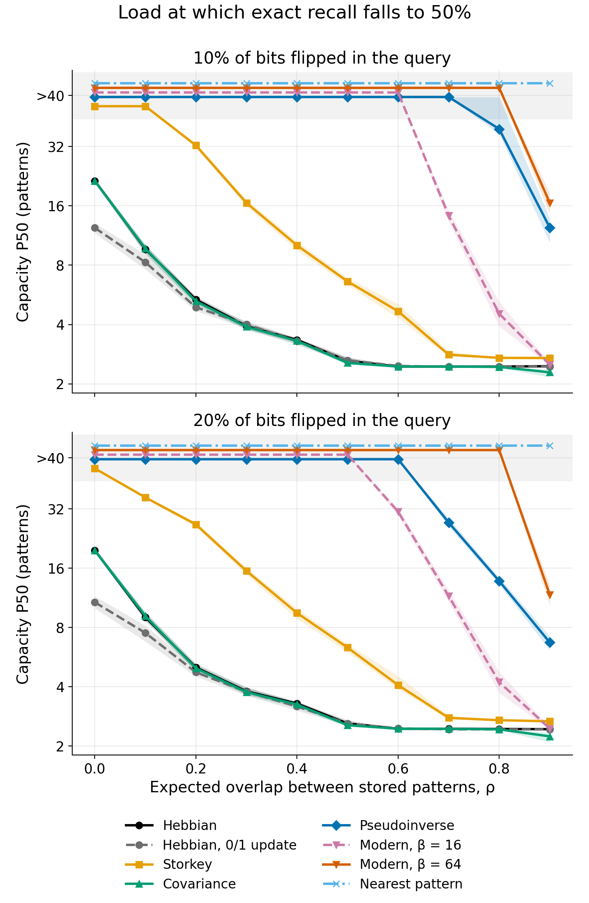

# Dense character pattern recall in Hopfield networks

A Hopfield network with Hebbian weights and the update given in the assignment recalls none of 18 dense character bitmaps from noisy copies. This study reports that baseline, corrected, and a capacity study on random patterns with controlled overlap and density, which compares nine recall rules and asks why the characters fail.
Coursework for CS 7063 Advanced Machine Learning, University of Cincinnati, Spring 2026; Extended November 2026.

The original submission (February 2, 2026) stored the patterns in an unsigned 8-bit type, so its weights and baseline numbers were wrong, and it scored each alternative method on a single run. This extended version reruns the baseline with correct weights and adds the capacity study. The write-up is a paper (LaTeX source in [`paper/`](paper/)) and a [chapter of the course book](https://ryanjosephkamp.github.io/advanced-ml-studies/classical-hopfield-networks/).

## Question

The assignment stores 18 character patterns in a Hopfield network with Hebbian weights and tries to recall them from copies with about 10% and 20% of the pixels flipped. The baseline recalled none of them, so the study asks three questions: how fast exact recall collapses as stored patterns grow alike, which learning rules hold up, and whether the characters fail from their density, from structure they share beyond density, or from the load.

## Setup

- Data: 18 binary 12×12 character patterns provided with the course (144 neurons), with 79.28% of pixels on. The test file flips 13 pixels in every pattern (9.03%). The 20% file, generated with seed 42, flips 21 to 39 (19.98% on average).
- Baseline: Hebbian weights on ±1 patterns with a zero diagonal, and the assignment's update on 0/1 states, one unit at a time in random order, until a full sweep changes nothing or 100 sweeps have run. A query counts as recalled only if it settles exactly on its own pattern.
- Capacity study: random 144-bit patterns that share a prototype (expected overlap ρ from 0 to 0.9, density 0.5) or have independent bits at density 0.65 or 0.80; loads from 2 to 40 patterns; 50 pattern sets per condition; and queries with 14 or 29 bits flipped (10% and 20%). Every rule sees the same patterns and queries, and every rule that updates one neuron at a time sees the same update orders (seed 20260202).
- Rules: Hebbian with the standard update, Hebbian with the assignment's 0/1 update, Storkey, pseudoinverse, covariance, a modern (softmax) network at β = 4, 16, and 64, and nearest-pattern lookup.
- Capacity P50 is the load at which exact recall first falls below 50%, interpolated in log P between tested loads. Intervals are 95% percentile intervals from 2,000 cluster-bootstrap resamples.
- The characters: every rule on the whole set of 18 over 200 draws of update order (for the rules that have one) and of noise (for fresh queries), and on random subsets of 2 to 18 characters, 200 per size.

## Results

- Baseline: 0 of 18 patterns recalled from the training, test, and 20% files. All 54 queries settle within 3 sweeps into one state, with 133 of 144 pixels on, 8 bits from stored patterns 11 and 16. The original submission's all-ones final state, 15 bits from the nearest pattern, came from the 8-bit overflow.
- Overlap: at 10% noise, the Hebbian P50 is 21.4 [21.0, 21.9] patterns for independent balanced patterns and 3.3 at an expected overlap of 0.4. The assignment's 0/1 update lowers the first figure to 12.4 [11.6, 13.1], a loss of 42%.
- Rules: on patterns that share a prototype, ranked by capacity from lowest to highest where their capacities can be told apart (Section V of the paper), these rules run: Hebbian and covariance, Storkey, the pseudoinverse rule, and the modern network at β = 64 and nearest-pattern lookup.
- Why the characters fail: density alone breaks Hebbian storage (P50 3.5 for independent bits at density 0.80). The covariance rule removes that density effect (29.2 on the same bits) but reaches only 4.4 on character subsets: the characters share structure beyond their density (mean Pearson correlation 0.208), and that structure and their uneven densities (59.7% to 89.6%) likely break the covariance rule together; the study did not separate the two. Under the 0/1 update, 18 patterns are past the 50% load even for random balanced patterns. The study cannot say how much each of the three contributes.
- On the characters, the pseudoinverse rule and the modern network at β = 64 recall all 18 from the test file. From the 20% file, the pseudoinverse rule recalls 13.78 of 18 on average over 200 update orders (10 to 18), and all 18 in 0.5% of them. The original submission's 17 of 18 was a single run; 7 of the 200 orders (3.5%) reach 17 or more.
- Storkey's rule depends on the order in which the patterns are stored: over 200 draws of storage order, noise, and update order, it recalls 2 to 9 of the 18 characters from 10% noise.



Capacity P50 against expected overlap ρ for patterns that share a prototype, at 10% (top) and 20% (bottom) noise, with 95% bands over 50 pattern sets. Capacities above 40 are drawn in the shaded band, offset by rule, and values between 2 and 3 are interpolated between those two tested loads.

Known and potential problems in this study, and the status of each, are listed in [`KNOWN-ISSUES.md`](../KNOWN-ISSUES.md#classical-hopfield-networks).

## Run it

```bash
pip install -r requirements.txt
python study/run_study.py
python study/analyze.py
python paper/make_numbers.py
```

Run the scripts from this folder, on a CPU. `run_study.py` runs the capacity study (about five minutes on one processor core), and `analyze.py` writes the summaries to `study/results/` and the figures to `study/figures/`. `paper/make_numbers.py` writes the paper's numbers and tables from those results and the committed baseline run in `hopfield_results/`, and `latexmk -pdf main.tex` in `paper/` builds the paper.

On an Apple silicon Mac, with the versions in `requirements.txt` (Python 3.11.5) and the OpenBLAS 0.3.23.dev that NumPy 1.26.4 bundles, running its ARMv8 kernel, `run_study.py` and `analyze.py` reproduced the committed study results and figures byte for byte. Pseudoinverse and Storkey runs that meet a field of 0 in exact arithmetic depend on rounding (for the pseudoinverse rule, some runs at an overlap of 0.9), so another NumPy version, BLAS build, or kernel can change them; `run_study.py` always uses one BLAS thread, as the committed run did.

The paper uses the committed baseline run. To rerun the baseline:

```bash
python scripts/kamp_hw2.py
```

`kamp_hw2.py` runs the assignment's baseline and the dataset statistics on the files in `data/` and writes each run to new timestamped folders in `hopfield_results/` and `dataset_stats/`; `--seed` and `--noise-percent` change the validation set. The committed folders hold the corrected rerun of November 11 and 12, 2026, although their names carry the original run's timestamp. `paper/make_numbers.py` stops if `hopfield_results/` holds more than one run, so move the new folder out of `hopfield_results/` before rebuilding the paper.

## License

The code is under the MIT License. The character patterns in `data/` (`characters.mat` and `test.mat`, and their CSV copies) were provided with the course assignment.
