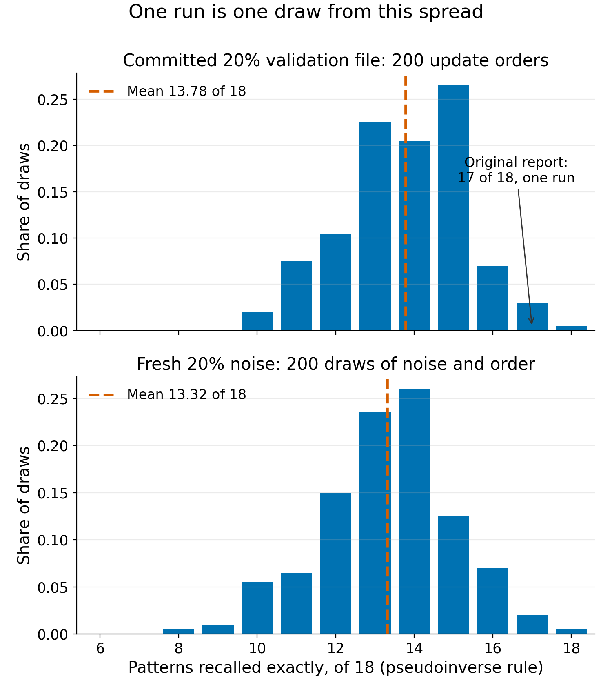

# *Alphabet amnesia*: why a Hopfield network forgets its letters

*Coursework for CS 7063 Advanced Machine Learning, Spring 2026 (Submitted February 2, 2026); Extended November 2026.*

A Hopfield network is a memory. Show it a damaged picture and it settles, step by step, into a stable picture (ideally the stored one it most resembles). This assignment stored 18 character bitmaps in one such network and gave it copies with a tenth and a fifth of the pixels flipped. It recalled none of them. This chapter follows that failure to its causes: how quickly recall collapses as stored pattern similarity grows, which learning rules survive, and what is wrong with the characters.

## The network and the patterns

Each character is a 12 by 12 grid of on and off pixels, so the network has 144 neurons. The weights are built from the stored patterns by the Hebbian rule: two neurons that usually agree (both on or both off) get a positive weight, and two that disagree get a negative one. To recall, the network updates one neuron at a time, in random order, and each neuron turns on or off according to the weighted vote of the others. The assignment's version keeps neurons at 0 and 1. The usual version uses −1 and +1, and the difference turns out to matter.

<!-- [[figure: the 18 characters as a 6 by 3 grid of 12 by 12 bitmaps, with the pixels flipped by the test file's 13-pixel noise or the 20% file's 21- to 39-pixel noise (about 29 on average) marked on any one character.]] -->
<!-- github -->

*Plate 1, live:* [The eighteen characters](https://ryanjosephkamp.github.io/advanced-ml-studies/classical-hopfield-networks/#plate-1), a live plate on the book's site.

<!-- /github -->

These characters are dense. 79.28% of the pixels are on (the background; the letters are drawn in off pixels), and 44 of the 144 pixels are on in every one of the 18 characters. Two characters agree, on average, with an overlap of 0.465, where an overlap of 0 means no more agreement than chance for balanced patterns. The closest pair, patterns 8 and 9 (counting from 0), differs in only 5 pixels.

<!-- [[figure (pop-out): the 18 by 18 matrix of pairwise overlaps between the characters, as a heat map; a tapped cell shows the two bitmaps side by side and the pixels where they differ.]] -->
<!-- github -->

*Plate 2, live:* [How alike the characters are](https://ryanjosephkamp.github.io/advanced-ml-studies/classical-hopfield-networks/#plate-2), a live plate on the book's site.

<!-- /github -->

## The first result: nothing is recalled

With the weights computed correctly, the network recalls none of the characters, from any query set, even from the clean training patterns. Every one of the 54 queries settles into the same state, with 133 pixels on, 8 bits from stored patterns 11 and 16. The standard update fails, too: over 200 random update orders, it recalls none of the 18, and none of the 18 characters is even a fixed point.

The original submission reported a different failure, an all-ones state, and blamed the density of the patterns. That result came from a bug: the patterns were stored in an unsigned 8-bit type, so turning a 0 into −1 wrapped around to 255, and the weights came out wrong. The numbers here replace it.

<!-- [[demo (pop-out): a Hopfield network on the 18 characters, run live in the page one neuron at a time. Choose the rule (Hebbian, Storkey, or pseudoinverse), the update (the assignment's 0/1 update or the standard ±1 update), and the characters stored; pick a query from the test file, the 20% file, or a noise slider, and watch the state on a 12 by 12 grid and its energy as a curve, the energy that the chosen update never raises. With all 18 stored under Hebbian weights and the assignment's update, every query falls into the same state; with fewer stored, more of the queries come back (in the study, most come back only with two stored). Storkey stores the characters in file order, and its result depends on that order (under the standard ±1 update, 3 of 18 fixed points in file order, 2 to 10 over 200 orders). It is an exploration, not one of the study's results.]] -->
<!-- github -->

*Plate 3, live:* [Watch it settle](https://ryanjosephkamp.github.io/advanced-ml-studies/classical-hopfield-networks/#plate-3), a live plate on the book's site.

<!-- /github -->

## How many patterns can a Hopfield network hold?

The question has an old answer for random patterns: [about 0.138 times the number of neurons](https://doi.org/10.1103/PhysRevLett.55.1530), if a few wrong bits are tolerated, and [fewer if every bit must come back](https://doi.org/10.1109/TIT.1987.1057328). The first is about 20 patterns for 144 neurons. The study asks what happens when the patterns are not independent and balanced. It builds sets of random patterns with a controlled overlap, from 0 (independent) to 0.9 (nearly identical), and also sets with a biased density, stores 2 to 40 of them, and measures how often the network recalls each exactly from 10% and 20% noise. Each condition has 50 pattern sets.

<!-- [[demo (3D, pop-out): a surface of exact recall over the number of stored patterns (2 to 40) and their expected overlap ρ (0 to 0.9), for one rule at a time, at 10% or 20% noise. It passes through the measured loads (2 to 9, then 12, 15, 18, 24, 30, and 40) and is interpolated between them; a tapped value snaps to the nearest measured point.]] -->
<!-- github -->

*Plate 4, live:* [The recall terrain](https://ryanjosephkamp.github.io/advanced-ml-studies/classical-hopfield-networks/#plate-4), a live plate on the book's site.

<!-- /github -->

For independent balanced patterns at 10% noise, the Hebbian network holds 21.4 patterns before exact recall falls to 50%. That is a different measure from the theory's: half of the patterns come back exactly, rather than nearly every bit of every pattern. All capacities in this chapter's text are at 10% noise and interpolated between the loads the study tested. With an expected overlap of 0.1, the network holds 9.6; at 0.2, it holds 5.4; at 0.3, 3.9; and at 0.4, 3.3. From an overlap of 0.5 up, recall is already below 50% with three patterns. Shared structure is expensive.

The assignment's 0/1 update costs capacity, too. It equals the standard update plus a bias on every neuron, which acts like extra crosstalk from the stored patterns, and on independent balanced patterns, it lowers the Hebbian capacity from 21.4 to 12.4, a loss of 42%.

<!-- [[figure (pop-out): study/figures/fig1_recall_vs_load.png. Exact recall against the number of stored patterns, one panel per rule and one curve per overlap.]] -->
<!-- github -->

*Plate 5.* Exact recall from 10% noise against the number of stored patterns, one panel per rule and one curve per overlap ρ, prototype family. Bands are 95% intervals over 50 pattern sets.

<!-- /github -->

## Which rules hold up

Four ideas change plain Hebbian storage. [Storkey's rule](https://doi.org/10.1007/BFb0020196) corrects each weight for the field the other patterns already produce, so the order of storage matters. The [pseudoinverse rule](https://doi.org/10.1051/jphyslet:01985004608035900) makes the stored patterns [fixed points](https://doi.org/10.1103/PhysRevA.35.380), apart from rare, nearly identical sets. The [covariance rule](https://doi.org/10.1103/PhysRevA.35.2293) subtracts the mean activity, which repairs a biased density but makes little difference for balanced patterns that share a prototype. A [modern Hopfield network](https://arxiv.org/abs/2008.02217) replaces the weighted vote with a softmax over the stored patterns.

On patterns that share a prototype, they keep a stable order wherever their capacities can be told apart, from lowest to highest capacity: Hebbian and covariance, Storkey, the pseudoinverse rule, and the modern network with a large inverse temperature (β = 64). Storkey holds well past Hebbian: 10.1 patterns at an overlap of 0.4, against 3.3. The pseudoinverse rule keeps recall high out to an overlap of 0.7 at 10% noise. The modern network with a large inverse temperature does better still (at β = 4, it falls below Storkey at overlaps of 0.1 to 0.6), and in the limit, it is simply a nearest-pattern lookup: it returns the stored pattern closest to the query (when there's no tie).

<!-- [[figure (pop-out): study/figures/fig2_capacity_vs_overlap.png. The load at which exact recall falls to 50%, against overlap, for eight of the nine rules (all but the modern network at β = 4), at 10% and 20% noise. Capacities above 40 sit in the shaded band at the top, offset by rule only to keep the lines apart, and a capacity between 2 and 3 is interpolated between the two loads tested there, 2 and 3 patterns.]] -->
<!-- github -->

![Two panels, at 10% and 20% noise, of the load at which exact recall falls to 50% against expected overlap from 0 to 0.9, one line for each of eight rules (all but the modern network at β = 4). Hebbian, its 0/1 update, and covariance fall fastest and Storkey more slowly; the modern network at β = 16 leaves the shaded band above 40 at an overlap of 0.7 (0.6 at 20% noise), the pseudoinverse rule at 0.8 (0.7 at 20%), and the modern network at β = 64 at 0.9, while nearest-pattern lookup stays in the band throughout.](../study/figures/fig2_capacity_vs_overlap.png)

*Plate 6.* Capacity P50 against expected overlap ρ, prototype family, at 10% and 20% noise. The log axis runs from 2 to 40 patterns. Capacities above 40 are drawn in the shaded band at the top, offset by rule so the lines stay apart, so a value just under 40, such as the pseudoinverse rule's 39.2 at ρ = 0.8, sits below the band. Values between 2 and 3 are interpolated between the two loads tested there; small capacities are compared through recall at *P* = 3.

<!-- /github -->

## Why the characters fail

For these characters, three things are true at the same time. The study can say what each does alone, but not how much each contributes.

1. **They are dense.**  
   Density alone is enough to break the Hebbian rule. Independent bits with a density of 0.80, which have no shared structure beyond their density, give a Hebbian capacity of 3.5. The covariance rule repairs that case, to 29.2, but biased patterns carry less information each, which may explain the higher number (the study didn't test this), so it's likely a different regime from the balanced 21.4, not a better one.
2. **They share structure beyond their density.**  
   The covariance rule does not repair the characters: on character subsets, its capacity is only 4.4. That suggests the structural similarity of the characters is more than just a matter of density, though their uneven densities may play a part, too. Their mean correlation, which takes out each character's own density, is still 0.208.
3. **They are numerous.**  
   18 patterns is a heavy load: below the standard update's capacity of 21.4 for random balanced patterns, but past the 0/1 update's 12.4.

<!-- [[figure (pop-out): study/figures/fig3_density_vs_structure.png. Capacity at 10% noise against mean overlap, one panel per rule, for patterns that share a prototype and for independent bits at densities 0.65 and 0.80: density against shared structure at a similar overlap. A capacity between 2 and 3 is interpolated between the two loads tested there, 2 and 3 patterns.]] -->
<!-- github -->

*Plate 7.* Capacity at 10% noise for the prototype family (line) and for independent biased bits (squares: density 0.65; diamonds: density 0.80), against mean pattern overlap. Values between 2 and 3 are interpolated between the two loads tested there; small capacities are compared through recall at *P* = 3.

<!-- /github -->

<!-- [[figure (pop-out): study/figures/fig4_characters_vs_synthetic.png. Exact recall of random subsets of the characters against the number stored, at 10% noise, one panel per rule, beside synthetic patterns at expected overlaps of 0.4 and 0.5 and at density 0.80.]] -->
<!-- github -->

*Plate 8.* Exact recall of random character subsets (solid) against synthetic patterns at ρ = 0.4 and 0.5 and at density 0.80, 10% noise.

<!-- /github -->

Load matters, too, and the most for the assignment's update. With the 0/1 update, 18 patterns are past the 50% point even for random balanced patterns. With the standard update, load alone costs about a quarter of the patterns at 10% noise.

The strong rules do better on the characters than the weak ones do, but not as well as on synthetic patterns of a similar mean overlap (the characters' 0.465 lies between expected overlaps of 0.4 and 0.5). With all 18 stored, at the end of the character-subset curves above, the pseudoinverse rule recalls 0.957 of the characters from fresh 10% noise, against 1.000 and 1.000 for synthetic patterns at expected overlaps of 0.4 and 0.5. A likely reason is the characters' close pairs, which a mean overlap hides. The study did not test that.

The pseudoinverse rule also shows how much one run can mislead. On the 20% file, it recalls 13.78 of 18 on average over 200 update orders, anywhere from 10 to 18. The 17 of 18 in the original submission was a lucky draw: 7 of the 200 orders reach 17 or more.

<!-- [[figure (pop-out): study/figures/fig5_pseudoinverse_order_spread.png. How many of the 18 characters the pseudoinverse network recalls from the 20% file over 200 update orders (top) and from fresh 20% noise over 200 draws of noise and order (bottom).]] -->
<!-- github -->

*Plate 9.* Pseudoinverse recall of the 18 characters at 20% noise: from the 20% file over 200 update orders (top), and from fresh 20% noise over 200 draws of noise and order (bottom). Dashed lines are the means.

<!-- /github -->

## What this does not show

- It does not split the characters' failure into shares for density, shared structure, and load. The characters have all three, and the study doesn't vary them separately.
- It uses one network size, two noise levels, and exact recall, which counts one wrong pixel as a failure.
- The capacity here is an empirical measure for this network size. It is not the capacity of the theory papers.
- Capacities below 40 are interpolated between the loads the study tested.
- The random pattern families are idealized. Real characters have richer structure.
- Storkey's rule depends on the order the patterns are stored in: on the characters, it recalls 2 to 9 of 18 from 10% noise over 200 draws of storage order, noise, and update order.

## Run it yourself

`pip install -r requirements.txt` installs the versions used here. `python study/run_study.py` runs the capacity study, which takes about five minutes on one processor core, and `python study/analyze.py` writes the summaries and figures. `python scripts/kamp_hw2.py` reruns the baseline into a new folder; the baseline numbers here come from the committed run. The original submission's 17 of 18 is history: it comes from that submission's own files, which are not in the repository.
