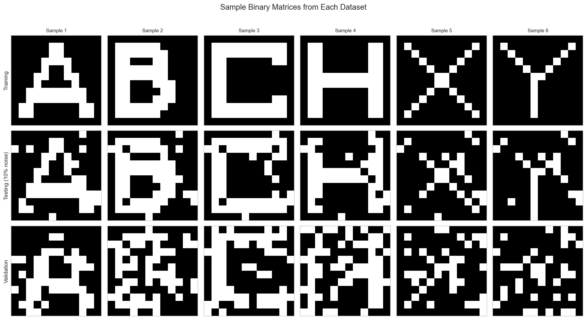
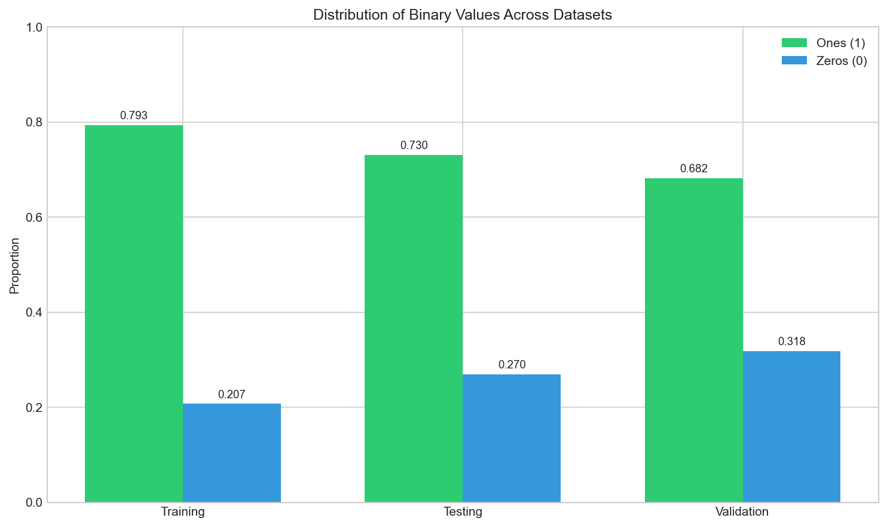
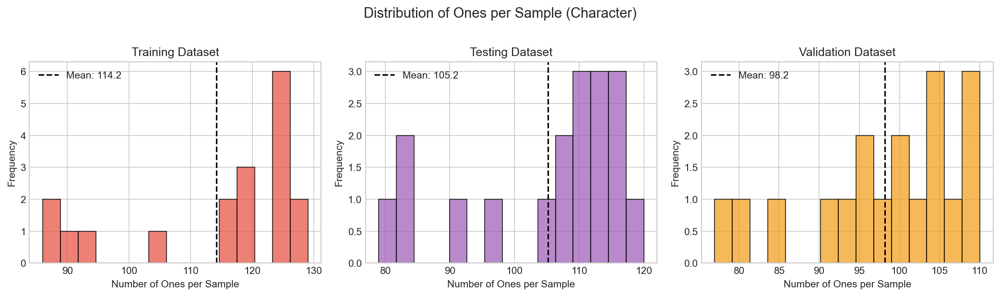
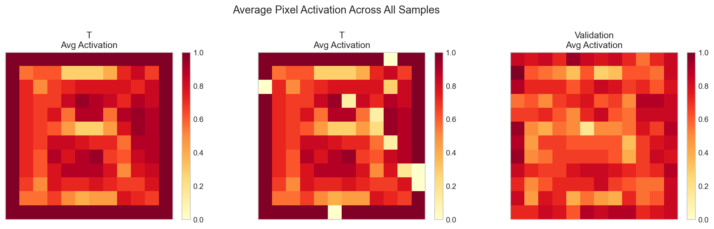
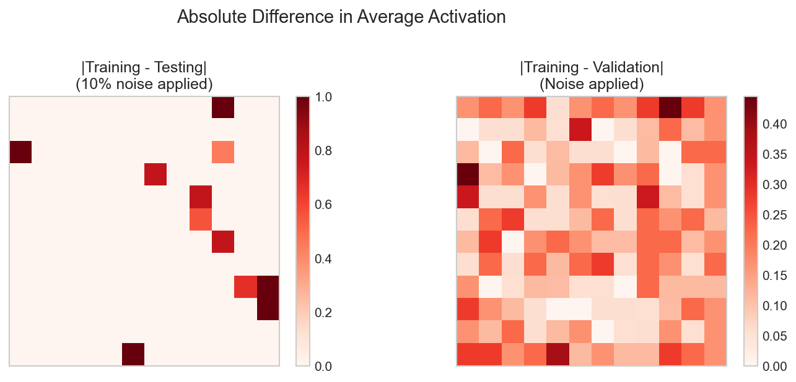
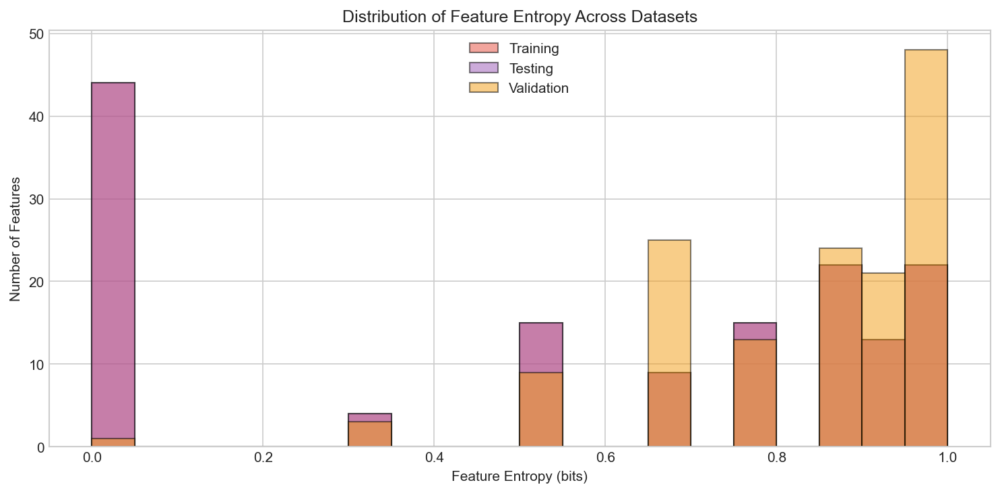
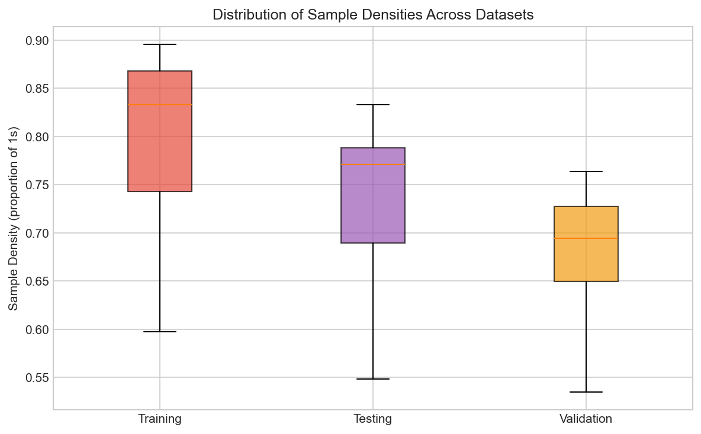

# Dataset Statistics Report

---

**Author:** Ryan Kamp  
**Affiliation:** Department of Computer Science, University of Cincinnati  
**Location:** Cincinnati, OH, USA  
**GitHub:** https://github.com/ryanjosephkamp

**Course:** CS7063 Advanced Machine Learning  
**Assignment:** Assignment 2 – Hopfield Networks  
**Date:** November 12, 2026

---

**Generated:** 2026-11-12 00:08:00
**Random Seed:** 42
**Validation Noise Percentage:** 20.0%

## Executive Summary

This report presents descriptive statistics for three binary image datasets:
1. **Training Dataset** (`characters.mat`): Original binary character matrices
2. **Testing Dataset** (`test.mat`): Training data with noise applied; 9.03% of pixels differ from it
3. **Validation Dataset**: Training data with 20.0% noise applied (seed=42); 19.98% of pixels differ from it

## Dataset Overview

| Metric | Training | Testing | Validation |
|--------|----------|---------|------------|
| Samples | 18 | 18 | 18 |
| Features (pixels) | 144 | 144 | 144 |
| Matrix Size | 12×12 | 12×12 | 12×12 |
| Total Binary Values | 2,592 | 2,592 | 2,592 |

## Binary Value Distribution

| Dataset | Ones Count | Zeros Count | Ones % | Zeros % |
|---------|------------|-------------|--------|---------|
| Training | 2,055 | 537 | 79.28% | 20.72% |
| Testing | 1,893 | 699 | 73.03% | 26.97% |
| Validation | 1,767 | 825 | 68.17% | 31.83% |

## Sample-Level Statistics

Statistics on the number of '1' values per sample (character):

| Dataset | Mean | Std Dev | Min | Max |
|---------|------|---------|-----|-----|
| Training | 114.17 | 14.53 | 86 | 129 |
| Testing | 105.17 | 12.50 | 79 | 120 |
| Validation | 98.17 | 9.52 | 77 | 110 |

## Density Statistics

Sample density represents the proportion of '1' values in each sample:

| Dataset | Mean Density | Std Dev |
|---------|--------------|---------|
| Training | 0.7928 | 0.1009 |
| Testing | 0.7303 | 0.0868 |
| Validation | 0.6817 | 0.0661 |

## Information Theory Metrics

| Dataset | Avg Feature Variance | Avg Feature Entropy (bits) |
|---------|---------------------|---------------------------|
| Training | 0.1264 | 0.5445 |
| Testing | 0.1264 | 0.5445 |
| Validation | 0.1939 | 0.8224 |

## Dataset Comparison

### Noise Analysis

| Comparison | Differing Values | Difference % | Expected % |
|------------|-----------------|--------------|------------|
| Training vs Testing | 234 | 9.03% | ~10% |
| Training vs Validation | 518 | 19.98% | 20.0% |

### Hamming Distance (per sample)

| Comparison | Mean | Std Dev |
|------------|------|---------|
| Training vs Testing | 13.00 | 0.00 |
| Training vs Validation | 28.78 | 4.60 |

### Feature Activation Correlation

- Training vs Testing: 0.5646
- Training vs Validation: 0.7528

## Visualizations

The following plots have been generated in the `plots/` subfolder:

- **Sample Matrices**: `plots/01_sample_matrices.png`
  

- **Binary Distribution**: `plots/02_binary_distribution.png`
  

- **Ones Per Sample**: `plots/03_ones_per_sample.png`
  

- **Feature Heatmap**: `plots/04_feature_heatmap.png`
  

- **Difference Heatmap**: `plots/05_difference_heatmap.png`
  

- **Feature Entropy**: `plots/06_feature_entropy.png`
  

- **Density Boxplot**: `plots/07_density_boxplot.png`
  

## Key Findings

1. **Noise:** the test set differs from the training patterns in 9.03% of pixels (13.00 per pattern on average, SD 0.00); the validation set in 19.98% (28.78 per pattern, SD 4.60), 0.02 points below the 20.0% requested.

2. **Density:** share of pixels that are 1: 79.28% (training), 73.03% (testing), and 68.17% (validation). Per training pattern: 86 to 129 of 144 pixels.

3. **Per-pixel agreement:** correlation between the training set's per-pixel counts of 1s and the noisy set's: 0.5646 (testing) and 0.7528 (validation).

---
*Report generated with seed=42, noise=20.0%*