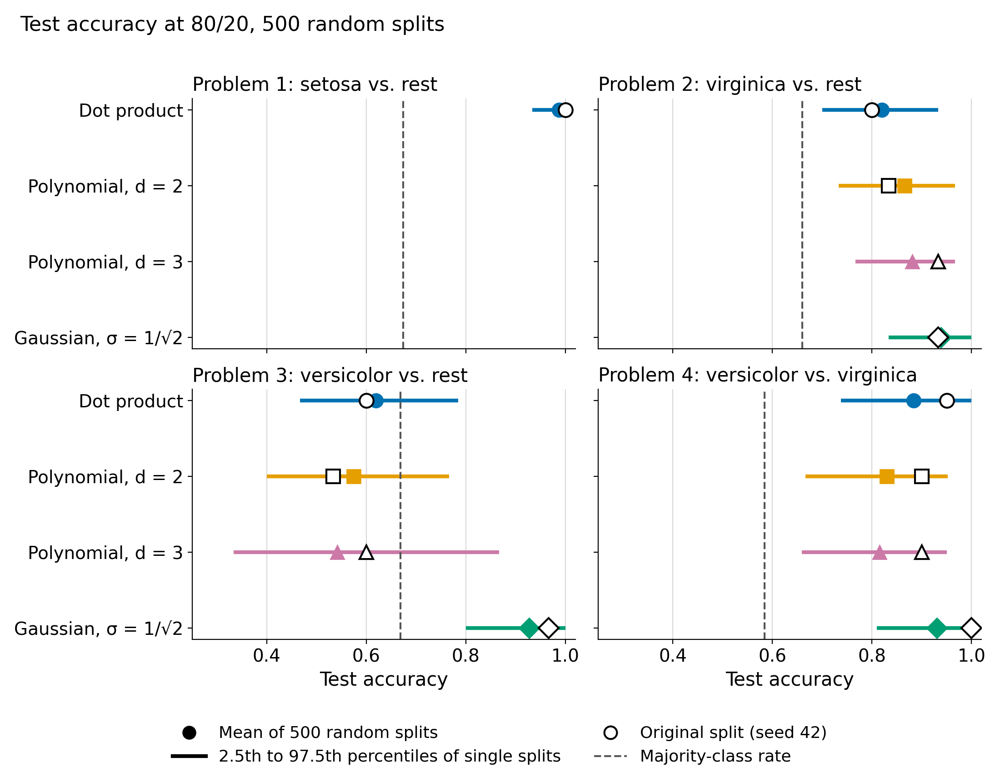

# Kernel choice for a Parzen-style classifier on Iris

This study compares four kernels in a Parzen-style classifier, which labels each flower by the class mean it is nearer to in the kernel's feature space, on four binary problems built from the Iris data. Over 500 random train/test splits per training share, the Gaussian kernel is the most accurate on the three problems that are not linearly separable, and the share of flowers used for training barely changes mean test accuracy averaged over all 13 problem–kernel pairs.
Coursework for CS 7063 Advanced Machine Learning, University of Cincinnati, Spring 2026; Extended November 2026.

The original submission evaluated each training share on one random split. This extended version evaluates every share on 500 random splits and keeps the original splits for comparison. The write-up is a paper (LaTeX source in [`paper/`](paper/)) and a [chapter of the course book](https://ryanjosephkamp.github.io/advanced-ml-studies/iris-parzen-classifier/).

## Question

The study asks which kernel (dot product, polynomial of degree 2 or 3, or Gaussian) classifies best on problems that range from linearly separable classes to a class that lies between the two parts of the other, and why. It also asks whether the share of flowers used for training changes accuracy.

## Setup

- Data: the 150 Iris flowers distributed with scikit-learn, 50 per species, with four measurements in centimeters, used unscaled.
- Problems: (1) setosa against the other two species, which is linearly separable and uses the dot product only; (2) virginica against the rest; (3) versicolor against the rest; (4) versicolor against virginica, with setosa removed (100 flowers).
- Classifier: every training point of a class gets the same weight, and a flower goes to the class whose mean in the kernel's feature space is nearer (the sign of the weighted kernel sum minus a bias). Kernels: x·y, (x·y + 1)², (x·y + 1)³, and the Gaussian exp(−‖x − y‖² / 2σ²) with σ = 1/√2, which the assignment set and which was not tuned.
- Evaluation: five training shares (90/10, 80/20, 70/30, 60/40, and 50/50), each with 500 random splits (scikit-learn's `train_test_split`, seeds 0 to 499, not stratified), the same splits for every problem and kernel: 32,500 fits. The results are the mean test accuracy, a 95% confidence interval for that mean, and the 2.5th to 97.5th percentiles of single splits. Because every split resamples the same 150 flowers, the interval describes the choice of splits only, not new flowers. Pooled over the five shares, the interval is computed from the 500 per-seed means (each the mean of one seed's five splits), because the five splits drawn with one seed share a shuffle and their test sets are nested. The baseline is the majority-class rate, the larger class's share of each test set.
- Original submission: one split per share (seed 42), 65 runs, kept for comparison. Its five test sets are nested, so each share is a single draw.
- An added comparison repeats the evaluation on the same splits with standardized features.

## Results

- On Problems 2 to 4, the Gaussian kernel has the highest mean test accuracy: 0.931 averaged over the three problems, against 0.775 for the dot product, 0.757 for degree 2, and 0.747 for degree 3. On the same split, it is at least as accurate as the best other kernel in 95.2% to 99.7% of splits.
- Problem 3 separates the kernels most. The dot-product, degree-2, and degree-3 kernels average 0.622, 0.574, and 0.546, all below the majority-class rate of 0.668; the Gaussian averages 0.926.
- On average, the training share barely matters. Averaged over the 13 problem–kernel pairs, mean test accuracy is 0.817, 0.816, 0.817, 0.817, and 0.816 from 90/10 to 50/50. Single pairs move more, by up to 0.033 across the five shares.
- With standardized features, the degree-2 kernel on Problem 3 rises from 0.574 to 0.853, and the Gaussian's lead over it shrinks from 0.35 to 0.06, so part of the kernel gap depends on the units.
- The original submission's single split per share was a favorable draw. On those splits, the Gaussian averaged 0.968 on Problems 2 to 4 (0.931 over random splits), and the mean over the 13 pairs ranged from 0.824 to 0.862 across shares. The original split scored above the mean of its 500 random splits in 46 of the 65 runs.



Test accuracy at 80/20 over 500 random splits. Filled markers are means, bars span the 2.5th to 97.5th percentiles of single splits, open markers are the original split (seed 42), and the dashed line is the mean majority-class rate.

Known and potential problems in this study, and the status of each, are listed in [`KNOWN-ISSUES.md`](../KNOWN-ISSUES.md#iris-parzen-classifier).

## Run it

```bash
pip install -r requirements.txt
python kamp_hw1.py
python repeated_splits.py
python paper/make_numbers.py
```

Run the scripts from this folder. They load Iris through scikit-learn, so there is nothing to download, and they run on a CPU. `kamp_hw1.py` runs the original single-split study and rewrites `parzen_classifier_results.csv`, the `split_*/` folders, and `comparison_analysis/`. `repeated_splits.py` checks that its classifier gives the original code's predictions on all 65 original runs, then runs the random-split evaluation and the standardized-feature comparison and rewrites `repeated_splits/`. `paper/make_numbers.py` writes the paper's numbers and tables from the result files, and `latexmk -pdf main.tex` in `paper/` builds the paper.

## License

The code is under the MIT License. The Iris data set is loaded through scikit-learn at run time; the course book's specimen plate carries a copy of the 150 flowers' measurements.
