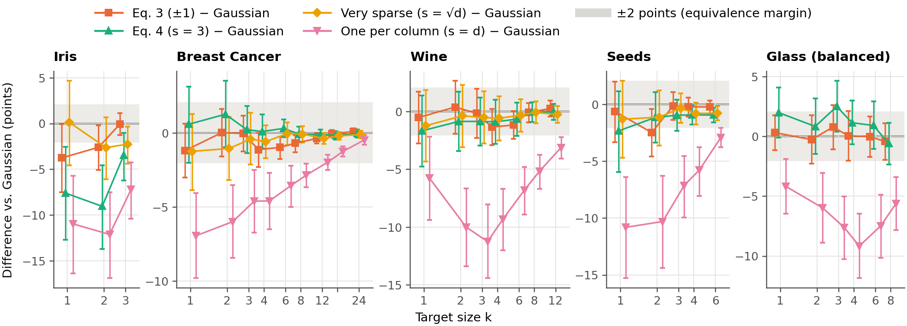

# Do sparse random projections preserve class structure? A paired study with support vector machines

This study projects five small UCI data sets to a few dimensions with dense and sparse random matrices and trains support vector machines (SVMs) on the result. With 100 paired draws per setting, the accuracy of Achlioptas's matrices and the very sparse matrices of Li, Hastie, and Church stays within about a point of a dense Gaussian matrix's outside Iris. The measure is the paired difference from the Gaussian, averaged over target sizes within each data set and then over the data sets other than Iris that the family was run on, each weighted equally (balanced accuracy for Glass). A matrix with one nonzero entry per column on average loses everywhere, and principal component analysis (PCA), which looks at the data, is more accurate than any of them at two dimensions.
Coursework for CS 7063 Advanced Machine Learning, University of Cincinnati, Spring 2026; Extended November 2026.

The original submission (February 14, 2026) compared a dense ±1 matrix (Eq. 3) with a sparse one (Eq. 4) on one matrix draw and one train/test split, with the best kernel chosen on the test set, and found Eq. 4 ahead on three of five data sets. This extended version repeats that pipeline over 100 draws and adds a paired study of five matrix families, target sizes from 1 to 24, tuned kernels, and PCA and all-feature baselines. The write-up is a paper (LaTeX source in [`paper/`](paper/)) and a [chapter of the course book](https://ryanjosephkamp.github.io/advanced-ml-studies/random-projections-multiclass-svm/).

## Question

The assignment projects each data set to k = 2 dimensions with Achlioptas's two matrices and compares SVMs with four kernels on the result. The extended study asks whether sparse random projections preserve class structure as well as dense ones, and how that depends on the target size k.

## Setup

- Data: Iris (150 rows, 4 features, 3 classes), Breast Cancer Wisconsin (Diagnostic) (569, 30, 2), Wine (178, 13, 3), Seeds (210, 7, 3), and Glass Identification (214, 9, 6, unbalanced), from the UCI Machine Learning Repository and stored in `data/`.
- Projection: E = XR/√k for a d × k random matrix R. The families are a Gaussian matrix (the dense reference); Eq. 3, with entries ±1; Eq. 4, with entries √3 times +1, 0, or −1 with probabilities 1/6, 2/3, and 1/6; a very sparse matrix, each entry nonzero with probability 1/√d (not run on Glass, where that makes it Eq. 4); and one nonzero per column on average (each entry nonzero with probability 1/d). Within a draw, all five are built from one Gaussian matrix and one uniform matrix: the Gaussian family is the Gaussian matrix itself, and each other family takes its signs, keeps an entry where the uniform matrix is below that family's nonzero probability 1/s (always, for Eq. 3), and multiplies it by √s, so every entry has variance 1. Eq. 3 differs from the Gaussian only in the sizes of its entries, and the sparse families also in their zeros.
- Original run (February 13, 2026): every feature scaled to [0, 1] on all rows, one Eq. 3 and one Eq. 4 matrix per data set from seed 42, k = 2, one stratified 70/30 split, and scikit-learn SVMs with linear, degree-2 polynomial, degree-3 polynomial, and RBF kernels at default settings. The report took the best kernel on the test set. The replication repeats this pipeline, on the same split, for seeds 0 to 99, which include 42.
- Extended study: target sizes 1, 2, 3, 4, 6, 8, 12, 16, and 24 below each data set's d, and 100 draws per setting, each with its own stratified 70/30 split and matrices, shared by every family in the draw, so the comparisons are paired. Features are scaled to [0, 1] on the training rows, projected, and standardized. Each kernel is tuned by 3-fold cross-validation on the training rows, and the kernel with the best inner score is scored on the test rows (balanced accuracy for Glass). PCA to k dimensions and all features are the references. In all, there are 17,900 classification rows.
- Statistics: 95% percentile bootstrap intervals over the 100 draws. The 144 primary comparisons (Eq. 3, Eq. 4, very sparse, and one per column against the Gaussian, and Eq. 4 against Eq. 3, at every data set and k) use paired t-tests with Holm's correction. A comparison is equivalent when its interval lies inside ±2 points.
- Distortion: the ratio q of projected to original squared distance for every pair of points at positive distance (all but one pair on Iris and on Glass), compared with its exact variance (checked on 2,000 of those pairs per data set over 20,000 draws) and with the per-pair tail bound of Dasgupta and Gupta.

## Results

- In the original submission's single draw, Eq. 4 minus Eq. 3 (best kernel each) was −15.6 points on Iris, 1.8 on Breast Cancer, 5.6 on Wine, 7.9 on Seeds, and −1.5 on Glass.
- Over 100 draws of the same pipeline, 52 put Eq. 4 ahead on three or more data sets, but the interval of the mean difference excludes zero only on Seeds (3.1 points, 95% interval 0.5 to 5.6) and Iris (−6.2, −10.1 to −2.4), unadjusted and on the report's one split. The report's Eq. 4 result on Seeds, 92.1%, is above 92 of the other 99 draws (median 81.0%).
- In the extended study, 28 of the 144 primary comparisons differ after Holm's correction, all of them losses: 27 are one nonzero per column against the Gaussian (by 1.3 to 12.1 points), and one is Eq. 4 on Iris at k = 2 (−9.0 points, which a Wilcoxon test with the same correction does not confirm). No comparison of Eq. 4 with Eq. 3 survives the correction.
- With the paired differences averaged the same way over target sizes, data sets (each weighted equally, where the family was run), and draws, Eq. 3 trails the Gaussian by 0.73 points, Eq. 4 by 1.47, and the very sparse matrix by 0.85. Without Iris, Eq. 4 trails by 0.16. Across all five data sets and the four non-Gaussian families, only 41 of the 114 primary comparisons with the Gaussian are equivalent within ±2 points, mostly at larger k.
- On Iris at k = 2, Eq. 4 leaves a column of the matrix all zero in 37 of the 100 draws. In those draws, it trails the Gaussian by 25.9 points; in the other 63, it is 0.9 points ahead (p = 0.59).
- At k = 2, PCA beats the Gaussian projection by between 5.3 points (Iris) and 23.8 points (Wine). Random projection comes within 2 points of all features in mean accuracy only at larger k, and never on Iris or Glass.
- The measured variance of q matches its exact formula to within about 4.0% in every cell, but the variance order does not explain the accuracy order. No target size here meets the Johnson–Lindenstrauss sufficient condition.



Paired difference from the Gaussian matrix in test accuracy (balanced accuracy for Glass), mean over 100 draws with 95% intervals, against target size k. The shaded band is ±2 points.

## Run it

```bash
pip install -r requirements.txt
python scripts/kamp_hw3.py --datasets iris breast_cancer wine seeds glass --legacy-seeding
python study/run_svm.py --datasets iris breast_cancer wine seeds glass
python study/run_distortion.py --datasets iris breast_cancer wine seeds glass
python study/replicate.py
python study/variance_check_many.py
python study/analyze.py
python study/figures.py
python paper/make_numbers.py
```

Run the scripts from this folder, on a CPU. The five data sets are read from `data/`, so nothing is downloaded. `kamp_hw3.py` is the original pipeline. With `--legacy-seeding`, it restarts the same seeded random stream for each data set, as the February 13, 2026, run did, and reproduces the original accuracies; without it, each data set gets its own stream. Without `--datasets`, only Iris and Breast Cancer run. Each run writes to new folders in `results/` and `printouts/` and regenerates the reports in `reports/`; the committed run is `results/original_run_20260213_172002/`. `python scripts/test_cli.py` tests the pipeline's command-line options.

`run_svm.py` and `run_distortion.py` write per-draw rows to `study/results/raw/`. Each stops after nine minutes by default and resumes when rerun, so repeat each until it no longer prints "rerun to resume". `replicate.py` runs the original pipeline for seeds 0 to 99, and `variance_check_many.py` repeats the variance check over 20,000 draws. `analyze.py` writes the summaries to `study/results/`, from the working files in `study/results/raw/` if they are there and from the committed `raw_*.csv.gz` copies otherwise, so the summaries and figures can be rebuilt without rerunning the study. Those copies hold rounded per-draw values, so rebuilding from them can change ties or decisions exactly at a threshold. `figures.py` draws the figures in `study/figures/`. `paper/make_numbers.py` writes the paper's numbers and tables from the result files, and `latexmk -pdf main.tex` in `paper/` builds the paper.

## License

The code is under the MIT License. The five data sets in `data/` come from the UCI Machine Learning Repository, which licenses them under Creative Commons Attribution 4.0 (CC BY 4.0); `data/README.md` lists their sources.
