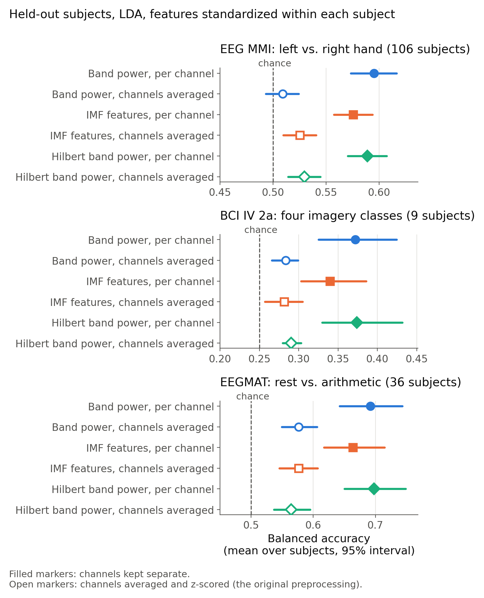

# EMD features for EEG classification: a corrected baseline and a band-power comparison

This study cuts electroencephalography (EEG) recordings from three public data sets into two-second windows, splits each window into intrinsic mode functions (IMFs) with empirical mode decomposition (EMD), and classifies and clusters features of the IMFs. The original pipeline scored at chance on motor imagery, and its highest clustering scores came from zero padding in the IMF rows and, likely, from outliers. This extended version corrects three bugs, reruns that pipeline, and asks whether EMD adds anything over plain band power on subjects the model has not seen.
Coursework for CS 7063 Advanced Machine Learning, University of Cincinnati, Spring 2026; Extended November 2026.

The write-up is a paper (LaTeX source in [`paper/`](paper/)) and a [chapter of the course book](https://ryanjosephkamp.github.io/advanced-ml-studies/signal-analysis-emd/).

## Question

The original coursework asked whether simple features of the IMFs separate EEG classes, and whether the distance used to compare them (Pearson correlation, Euclidean, or Itakura–Saito) changes nearest-neighbor classification and clustering: three features, three distances, two tasks, and three data sets make 54 experiments. The extended study asks whether per-channel EMD features add anything over Welch band power on held-out subjects.

## Setup

- EEG Motor Movement/Imagery (EEG MMI, PhysioNet): imagined left or right fist (runs 4, 8, and 12), channels C3, Cz, and C4, one window per cue. 106 of the 109 subjects and 4,767 windows: S088, S092, and S100 were recorded at 128 Hz, not 160 Hz, and are left out.
- BCI Competition IV data set 2a (BCI IV 2a): 9 subjects, four imagined classes (left hand, right hand, both feet, and tongue), the training sessions, channels C3, Cz, and C4, one window per cue, 2,590 windows.
- EEG During Mental Arithmetic Tasks (EEGMAT, PhysioNet): 36 subjects with a rest recording and a serial-subtraction recording each, channels Fp1, Fp2, F3, F4, and Fz, cut into consecutive windows: 4,266 windows, 3,186 at rest and 1,080 during arithmetic. Every recording ends with about a second that is not EEG, so its last window is dropped.
- Original pipeline (`scripts/`): each window is averaged over its channels, z-scored, and decomposed with EMD, and one feature (variance, histogram entropy, or mean absolute instantaneous frequency) is taken from each of the first four IMFs, with the residue kept apart. On EEGMAT, the pipeline leaves out the 6 windows for which EMD gives fewer than four IMFs, so it uses 4,260. Classification uses k-nearest neighbors (KNN, k = 5) on one stratified 70/30 split of windows (seed 42). Clustering uses k-means with one cluster per class, scored by the silhouette under each distance and by the adjusted Rand index (ARI) against the classes.
- Extended study (`study/`): channels kept separate or averaged; Welch band power in five bands (1–4, 4–8, 8–13, 13–30, and 30–45 Hz), the four-IMF features, and Hilbert band power of all IMFs in the same bands; shrinkage linear discriminant analysis (LDA) and KNN; evaluated on the window split, within subjects (5-fold cross-validation), and on held-out subjects, the last two with 95% bootstrap intervals over subjects, per-subject permutation tests, and Wilcoxon signed-rank tests with Holm's correction for paired differences. The signed-rank test ranks the differences rounded to ten decimal places, so zeros drop and ties share a rank; the intervals use the unrounded differences. Before the logarithm or the Itakura–Saito distance, a zero is replaced by its feature's smallest positive value over all windows, held-out ones included, or by 1 if there is none, without labels. In band power, this changes only the 30–45 Hz Hilbert band power of EEG MMI: 16 windows with the channels averaged and, with the channels kept separate, 53 values across 37 windows. In the original features, it changes the zero-padded slots of every window with fewer than eight EMD rows.

## Results

The original run (March 9, 2026) counted EMD's residue as an IMF and zero-padded every window to eight rows, read the three 128 Hz subjects as 160 Hz, and kept the padded last window of each EEGMAT recording. The original report also described the data sets with incorrect counts; the counts above come from the actual run. With the bugs fixed, the original pipeline gives these results on its one split ([results](results/run_2026-11-11_01-25-31/)), with the original submission's values in parentheses:

- EEG MMI: balanced accuracy 0.499 to 0.510 over the nine feature and distance pairs, at the 0.50 chance level (weighted F1 0.492 to 0.521).
- BCI IV 2a: 0.225 to 0.278, near the 0.25 chance level (weighted F1 0.222 to 0.262).
- EEGMAT: the best pair (instantaneous frequency, Euclidean) has weighted F1 0.703 and accuracy 0.730, against 0.639 and 0.747 for always predicting rest, and balanced accuracy 0.572 (weighted F1 0.706, against 0.633 for always predicting rest).
- Clustering: the ARI against the classes is between −0.023 and 0.035 everywhere. The original 0.908 silhouette (EEG MMI, entropy, Pearson) measured how many rows EMD returned per window and falls to 0.143 after the fixes; the original 1.000 (EEGMAT, variance, Euclidean) likely reflects outliers split off on their own.

The extended study helps explain why the original pipeline sits at chance on motor imagery: averaging C3, Cz, and C4 nearly cancels the left-right difference in power that the separate channels carry (EEG MMI, right minus left hand at 12 Hz: −0.48 dB at C3, +0.61 dB at C4, and −0.02 dB in the average). With channels kept separate ([results](results/study/)):

- On held-out subjects, band power with LDA reaches balanced accuracy 0.595 on EEG MMI (chance 0.50), 0.372 on BCI IV 2a (0.25), and 0.692 on EEGMAT (0.50), with each subject's features standardized over all of that subject's windows (no labels used), and 0.569, 0.315, and 0.593 without that step.
- On held-out subjects with LDA, the mean difference between Hilbert band power from the IMFs and Welch band power runs from −0.010 to 0.006 across the three data sets and both normalizations. The four-IMF features score lower than band power, by 0.020 to 0.032 standardized and 0.013 to 0.041 unstandardized. Over all 144 comparisons of an EMD feature set with band power, including a check with a later BCI IV 2a window, 2 pass Holm's correction, both in favor of band power. EMD features come close to band power at best, and none beats it here after Holm's correction (no equivalence test was run).
- On EEGMAT, rest and arithmetic are separate recordings made in a fixed order, and most of the held-out accuracy above chance comes from the frontal-polar channels Fp1 and Fp2. Without them, it falls to 0.553 (0.520 unstandardized), and with them alone, it is 0.665 (0.571 unstandardized). Their largest class differences are in slow and fast power, the usual signature of eye movements and muscle activity, though the data set's documentation reports that such artifacts were removed with independent component analysis, so any left would be residual. The held-out EEGMAT result may partly reflect recording order and non-cortical activity.



Balanced accuracy on held-out subjects with LDA and features standardized within each subject, with 95% intervals over subjects. Filled markers keep the channels separate; open markers average them.

Known and potential problems in this study, and the status of each, are listed in [`KNOWN-ISSUES.md`](../KNOWN-ISSUES.md#signal-analysis-emd).

## Data

The raw recordings are not in the repository. `scripts/download_data.py` downloads the 408 files the code reads (about 1.3 GB) from PhysioNet and the BCI Competition IV site into a folder you choose and checks each one against the SHA-256 sums in `data/raw_files.sha256`. Sources and citations are in [data/README.md](data/README.md).

## Run it

```bash
pip install -r requirements.txt
python scripts/download_data.py /path/to/raw          # --dry-run lists the files first
python scripts/kamp_hw4.py --raw-dir /path/to/raw --cache-dir /path/to/cache
python study/run_study.py --raw-dir /path/to/raw --cache-dir /path/to/cache
python study/extra_checks.py --cache-dir /path/to/cache
python paper/make_numbers.py
```

Run the scripts from this folder. `kamp_hw4.py` runs the 54 experiments of the corrected original pipeline and writes a timestamped folder under `results/`; `--datasets`, `--features`, `--similarity`, and `--task` select a subset. `run_study.py` caches the study's features in `--cache-dir`, evaluates them, and writes the result tables and figures to `results/study/`, in about 8 minutes on a laptop CPU. `extra_checks.py` repeats the per-subject permutation tests with 10,000 shuffles and tests EEGMAT channel and band subsets, in under 2 minutes. `paper/make_numbers.py` writes the paper's numbers and tables from the result files, and `latexmk -pdf main.tex` in `paper/` builds the paper.

## License

The code is under the MIT License. The EEG data come from three public data sets that keep their own terms, not the MIT License. The two PhysioNet data sets are under the Open Data Commons Attribution License v1.0, and BCI Competition IV asks users to credit the Graz group that recorded data set 2a and to cite a paper from its description. [data/README.md](data/README.md) gives the full citations.
