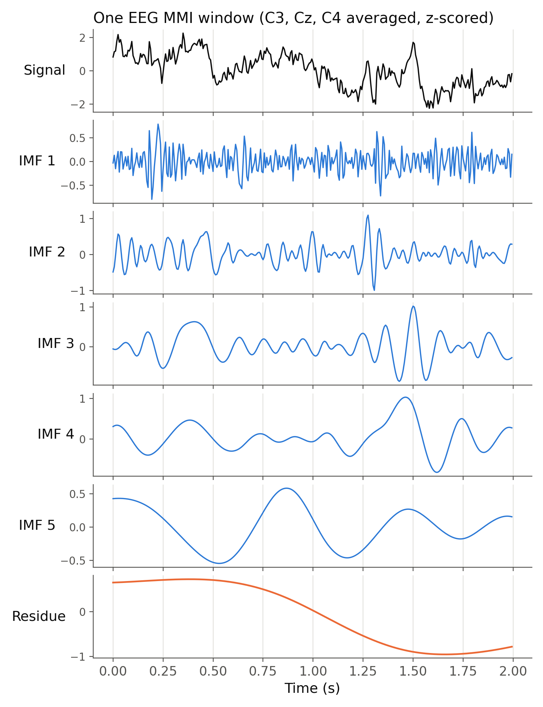

# *EMD for EEG*

*Coursework for CS 7063 Advanced Machine Learning, Spring 2026 (Submitted March 9, 2026); Extended November 2026.*

Empirical mode decomposition, EMD, takes a wiggly signal and peels it into a few simpler oscillations without choosing them in advance. Electroencephalography (EEG) is exactly that kind of signal: nonstationary and different in every person. The assignment asked whether features built from those oscillations can tell what someone's brain is doing. The answer took two rounds. The first gave chance-level results on motor imagery and some impressive-looking scores that meant nothing. The second asks a better question and compares EMD to a plain spectral baseline.

## What EMD does

Give EMD one window of signal. It finds the fastest oscillation riding on the signal, subtracts it, finds the fastest remaining oscillation, and repeats. The pieces are the intrinsic mode functions, the IMFs, and what is left at the end is the residue. Add them all back and you get the original window.

<!-- [[demo (pop-out): one real EEG MMI window from the study, the signal with its five IMFs and the residue. Each piece can be turned on, off, or down, and with every piece at full level, the sum rebuilds the signal within the file's rounding.]] -->
<!-- github -->

*Plate 1, live:* [Take the window apart](https://ryanjosephkamp.github.io/advanced-ml-studies/signal-analysis-emd/#plate-1), a live plate on the book's site.

<!-- /github -->

## The data

Three public data sets. In EEG Motor Movement/Imagery (EEG MMI), 106 people imagine closing the left or right fist, recorded at C3, Cz, and C4, over the motor cortex. BCI Competition IV 2a (BCI IV 2a) has 9 people imagining four movements. EEG During Mental Arithmetic Tasks (EEGMAT) has 36 people at rest and then doing mental arithmetic, and the study uses five channels over the front of the head. The motor-imagery recordings give one two-second window per cue, and the EEGMAT recordings are cut into consecutive two-second windows. About three-quarters of the EEGMAT windows are rest.

## What the first round found

The original pipeline averaged the channels, scored at chance on motor imagery, and posted silhouette scores as high as 1.000 for clustering. Later checks help explain both results.

Chance first. The labels are fine. Imagining a right-hand movement lowers a rhythm called mu over the left side of the head, and the left hand does the opposite. At 12 Hz on EEG MMI, right minus left is −0.48 dB at C3 and 0.61 dB at C4. Average the three channels and they nearly cancel.

<!-- [[demo (3D, pop-out): a head you can turn, with the three analyzed electrodes, C3, Cz, and C4, colored by the right-minus-left difference in power at the frequency on a slider, for EEG MMI or BCI IV 2a, and no scalp map between them. At 12 Hz on EEG MMI, C3 is blue, C4 orange, and the channel average close to zero. Below the head, a strip shows the difference spectra of C3, Cz, C4, and their average with pointwise 95% bands.]] -->
<!-- github -->

*Plate 2, live:* [Right minus left, at the scalp](https://ryanjosephkamp.github.io/advanced-ml-studies/signal-analysis-emd/#plate-2), a live plate on the book's site.

<!-- /github -->

Now, the silhouettes. EMD returns a different number of rows for different windows, and the original code padded the short ones with zeros, so the entropy features grouped windows by how many rows EMD returned, not by class. The EEG MMI entropy silhouette (Pearson distance) fell from 0.908 to 0.143 after the fixes. The top score, 1.000, likely reflects outliers split off on their own, not the classes. The corrected baseline is still at chance on motor imagery, with balanced accuracy from 0.499 to 0.510 on EEG MMI. A permutation null for the original window split, built on the corrected windows, shuffles window labels freely across subjects and recordings, so a score that clears it does not show task information.

<!-- [[figure (pop-out): results/study/figures/fig7_imf_example.png. The corrected IMF example: one EEG MMI window, its five IMFs, and the residue.]] -->
<!-- github -->

*Plate 3.* One EEG MMI window: the signal, its five IMFs, and the residue.

<!-- /github -->

<!-- [[figure (pop-out): results/study/figures/fig6_null.png. The permutation null for the original window split, with the March and corrected results marked.]] -->
<!-- github -->

*Plate 4.* Null distribution of weighted F1 for the window split (600 shuffles, 200 for each of three configurations, pooled), with the March values and the corrected values marked. The null is built on the corrected windows. The narrow EEGMAT peak is the null of the LDA configuration. Always predicting rest scores 0.639 on the corrected EEGMAT windows and 0.633 on the March ones, so the March values sit against a null for slightly different windows.

<!-- /github -->

## The second round: new subjects

A better test is a person the model has never seen. The study holds each subject out in turn (in 10 groups for EEG MMI), trains on everyone else, and scores the held-out subject. It keeps the channels separate, adds a band-power baseline, and adds Hilbert band power computed from the IMFs. One detail needs naming: standardizing each subject's features over their own recordings, without labels, helps, but it needs the new person's whole unlabeled session. The numbers below give both versions. A smaller detail: a zero Hilbert band power, which 16 EEG MMI windows have at 30 to 45 Hz with the channels averaged (37 with them kept separate), is replaced by the smallest positive value of that feature over all windows, held-out people's included, also without labels.

Band power per channel, with linear discriminant analysis (LDA), classifies held-out people above chance. Balanced accuracy, standardized within each subject: 0.595 on EEG MMI (chance 0.50), 0.372 on BCI IV 2a (chance 0.25), and 0.692 on EEGMAT (chance 0.50). Without standardizing: 0.569, 0.315, and 0.593.

<!-- [[figure (pop-out): results/study/figures/fig1_heldout.png. Held-out subjects with LDA and features standardized within each subject: balanced accuracy for six feature sets on each data set with 95% intervals and the chance line.]] -->
<!-- github -->

*Plate 5.* Held-out subjects, LDA, features standardized within each subject: balanced accuracy for six feature sets on each data set, with 95% intervals and the chance line.

<!-- /github -->

Keeping the channels separate matters. On held-out subjects, with LDA and features standardized within each subject, averaging them (with the original z-scoring of each window) costs between 0.050 and 0.134 in balanced accuracy (about 0.007 to 0.067 unstandardized). On BCI IV 2a, with 9 subjects, none of these differences can pass the correction for multiple comparisons. Without standardizing, the gain is smaller, and for band power on EEGMAT, it no longer passes the correction.

## Does EMD add anything?

Not that this study could detect. Hilbert band power computed from the IMFs comes close to ordinary band power on held-out people: with LDA and the channels kept separate, the mean difference ranges from −0.010 to 0.006 across the three data sets, with and without standardizing. The IMF features themselves are a little worse. Across 144 comparisons of an EMD feature set with band power, including a check with a later BCI IV 2a window, 10 have an interval above zero, none of them by more than about 0.030 on average, and 2 survive a correction for multiple comparisons, both in favor of band power and both within subjects (the IMF features on EEG MMI and EEGMAT).

<!-- [[figure (pop-out): results/study/figures/fig3_emd_vs_bandpower.png. The difference between per-channel EMD features and band power with LDA, held out (standardized within each subject) and within subjects (EEG MMI and BCI IV 2a only), with Holm-adjusted p.]] -->
<!-- github -->

*Plate 6.* Per-channel IMF features and Hilbert band power minus band power, LDA, with Holm-adjusted *p*: on held-out subjects with features standardized within each subject (top), and within subjects for EEG MMI and BCI IV 2a (bottom; EEGMAT is left out there).

<!-- /github -->

## The mental arithmetic puzzle

EEGMAT looks like the success story. Within subjects, it scores 0.946. Held out, it scores 0.692, with features standardized within each subject (0.593 unstandardized).

Two things to know:

1. Rest is recorded first, in its own file, so within a person a classifier can tell the two recordings apart.
2. Most of the held-out accuracy above chance comes from the two electrodes on the forehead.

Without Fp1 and Fp2, it falls to 0.553 (0.520 unstandardized). The alpha band alone, where mental arithmetic should show up, gives 0.531 (standardized; 0.512 unstandardized). Slow and fast power at the forehead is what eye movements and muscle activity look like (the data set's authors report removing such artifacts, so any left would be residual). So the held-out number may partly reflect recording order and non-brain activity.

<!-- [[demo (pop-out): the EEGMAT subset table as a switchboard. Channels and bands switch on and off; the seven combinations the study ran show their committed accuracy, any other combination with at least one channel and one band says it was not run, and a selection with no channel or no band says it has no features.]] -->
<!-- github -->

*Plate 7, live:* [The EEGMAT switchboard](https://ryanjosephkamp.github.io/advanced-ml-studies/signal-analysis-emd/#plate-7), a live plate on the book's site.

<!-- /github -->

## The old way overstates

The original test split windows at random, so windows of the same recording land on both sides. On EEGMAT, k-nearest neighbors (KNN) with per-channel band power scores 0.783 that way and 0.595 on held-out people (unstandardized). On EEG MMI, the two agree.

<!-- [[figure (pop-out): results/study/figures/fig5_leak.png. Euclidean KNN on the original window split against held-out subjects (unstandardized), six feature sets per data set.]] -->
<!-- github -->

*Plate 8.* Euclidean KNN on the original window split against held-out subjects, six feature sets per data set. The held-out points use the features as they are.

<!-- /github -->

## Clustering

Clusters never find the classes: the adjusted Rand index (ARI) against the classes is between about −0.019 and 0.066 for every feature set, method, and distance. On BCI IV 2a, they partly find the subjects. In 52 of 100 average-linkage runs, including the later BCI IV 2a window, at least 95% of windows land in one cluster, which is consistent with a few outliers split off on their own.

<!-- [[figure (pop-out): results/study/figures/fig8_clustering.png. ARI of k-means against classes, subjects, and EMD row count (the row-count marker exists only for the original features).]] -->
<!-- github -->

*Plate 9.* The adjusted Rand index (ARI) of k-means clusters, with as many clusters as classes, against the classes, the subjects, and, for the original features only, the EMD row count, on EEG MMI, BCI IV 2a, and EEGMAT.

<!-- /github -->

## What this does not show

- These are not competitive brain–computer interface (BCI) results. Three or five channels, five bands, two-second windows, and no spatial filtering are deliberate simplifications.
- With 9 subjects in BCI IV 2a, no paired comparison can pass the multiple-comparison correction, and bootstrap intervals over 9 numbers may run too narrow.
- The held-out EEGMAT result may partly reflect recording order and non-cortical activity.
- Standardizing within a held-out subject needs that subject's whole unlabeled session.

## Run it yourself

`scripts/download_data.py` fetches and verifies the raw files. `scripts/kamp_hw4.py` runs the corrected baseline, `study/run_study.py` the study, and `study/extra_checks.py` the per-subject tests and the EEGMAT subsets.
