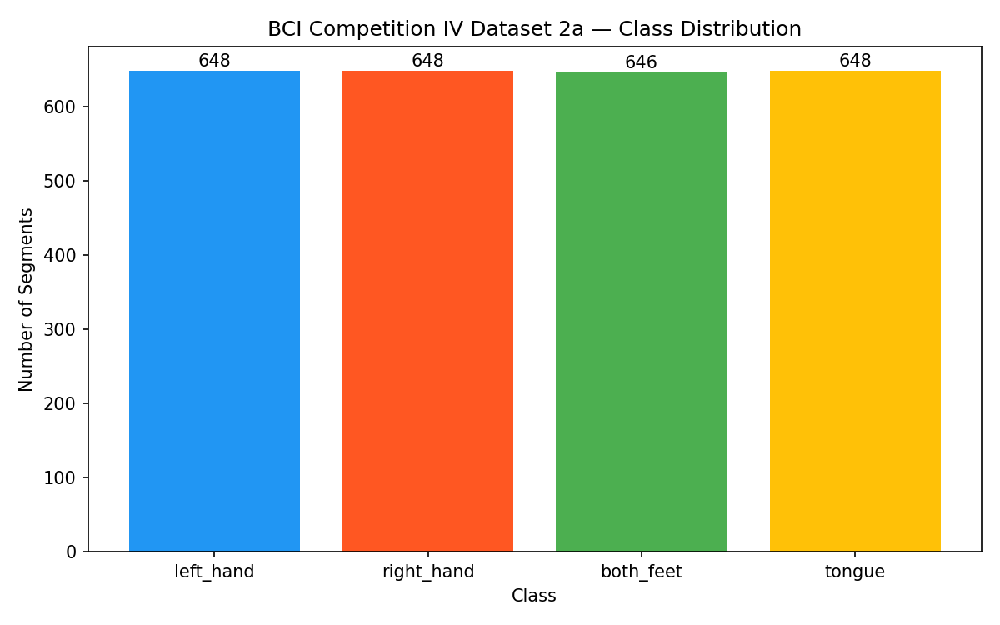
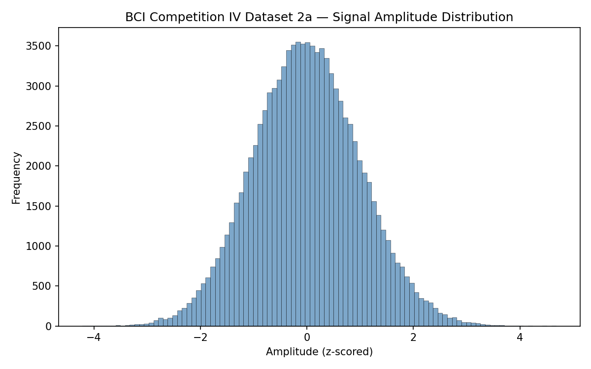
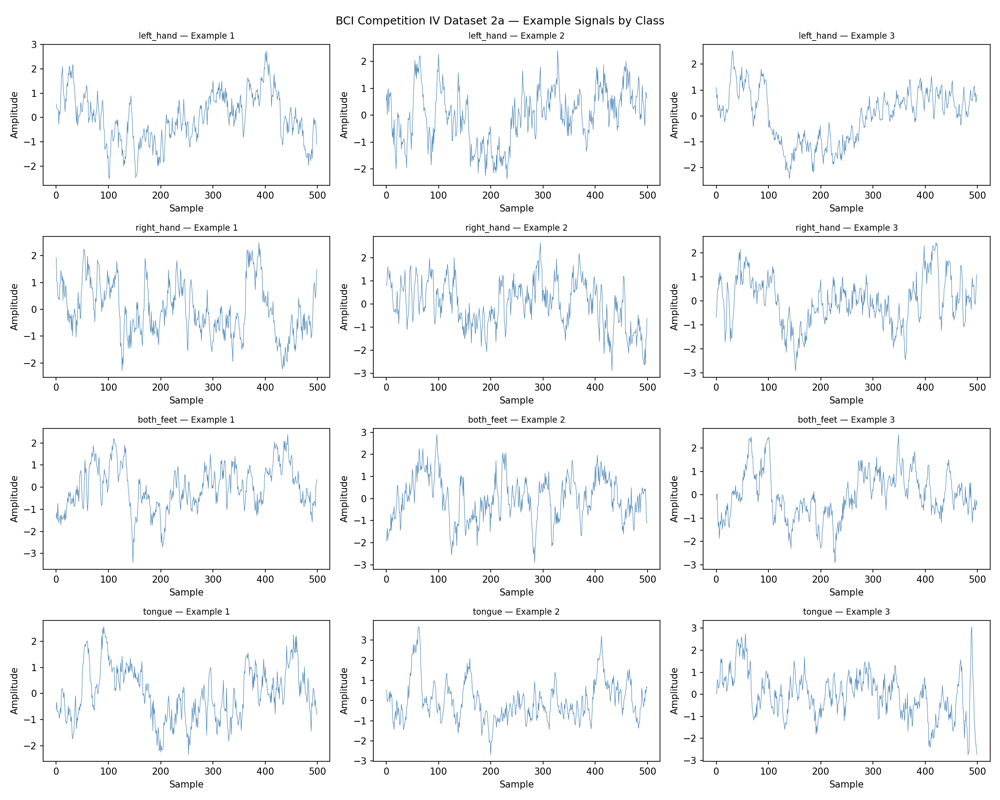

# Dataset Statistics: BCI Competition IV Dataset 2a

## Metadata

| Property | Value |
|---|---|
| Dataset | BCI Competition IV Dataset 2a |
| Source | http://www.bbci.de/competition/iv/ |
| Subjects | 9 |
| Channels | 3 (EEG-C3, EEG-Cz, EEG-C4) |
| Sampling Rate | 250.0 Hz |
| Segments | 2590 |
| Samples/Segment | 500 |
| Window Duration | 2.00 sec |

## Signal Statistics

| Statistic | Value |
|---|---|
| Mean | -0.000000 |
| Std Dev | 1.000000 |
| Min | -6.749258 |
| Max | 6.682297 |
| Median | -0.012231 |

## Class Distribution

| Class | Count | Percentage |
|---|---|---|
| left_hand | 648 | 25.0% |
| right_hand | 648 | 25.0% |
| both_feet | 646 | 24.9% |
| tongue | 648 | 25.0% |

## Figures

