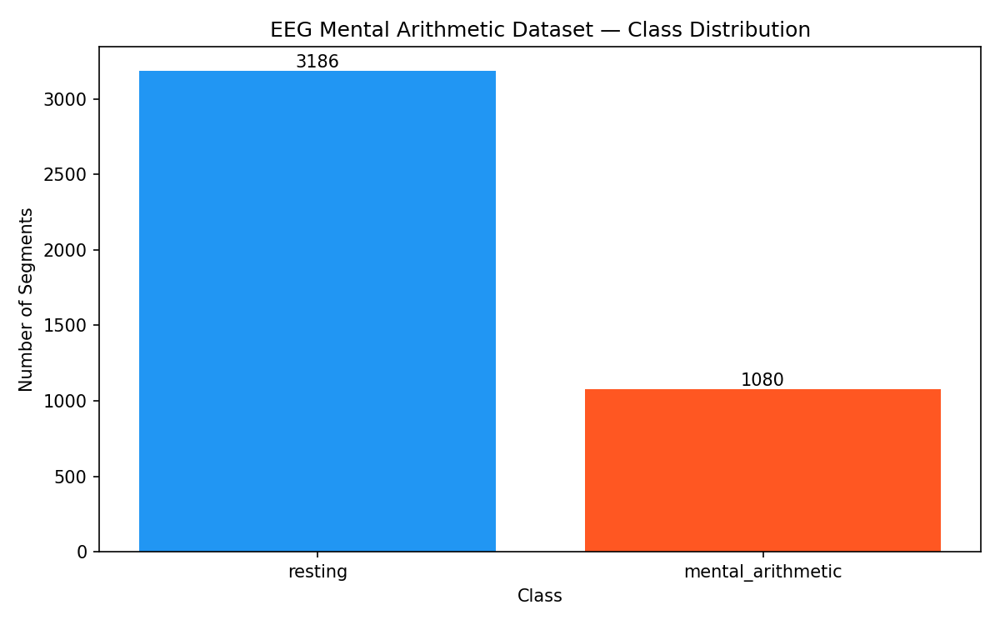
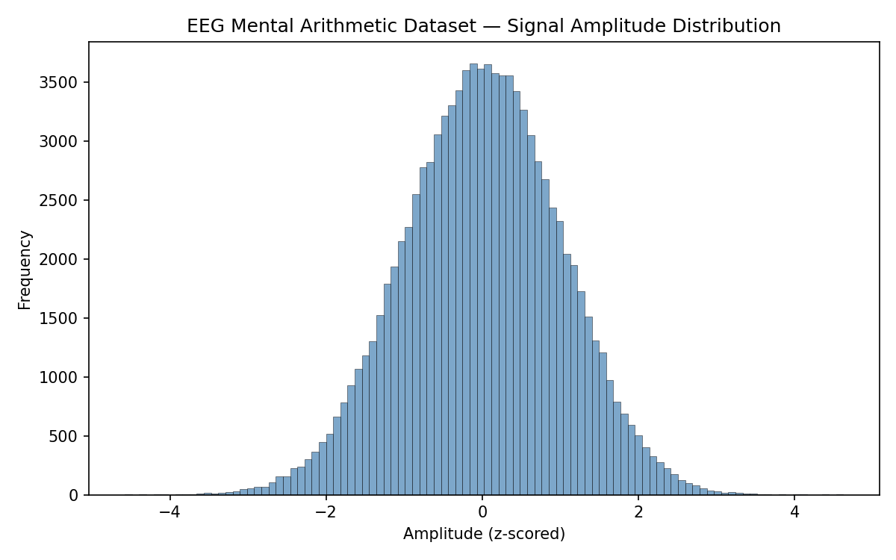
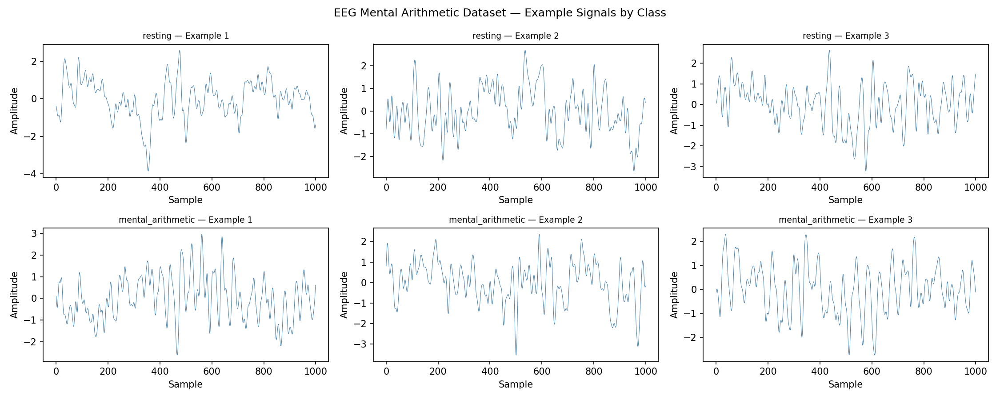

# Dataset Statistics: EEG Mental Arithmetic Dataset

## Metadata

| Property | Value |
|---|---|
| Dataset | EEG Mental Arithmetic Dataset |
| Source | https://physionet.org/content/eegmat/1.0.0/ |
| Subjects | 36 |
| Channels | 5 (EEG Fp1, EEG Fp2, EEG F3, EEG F4, EEG Fz) |
| Sampling Rate | 500.0 Hz |
| Segments | 4266 |
| Samples/Segment | 1000 |
| Window Duration | 2.00 sec |

## Signal Statistics

| Statistic | Value |
|---|---|
| Mean | 0.000000 |
| Std Dev | 1.000000 |
| Min | -5.803978 |
| Max | 5.502990 |
| Median | 0.010382 |

## Class Distribution

| Class | Count | Percentage |
|---|---|---|
| resting | 3186 | 74.7% |
| mental_arithmetic | 1080 | 25.3% |

## Figures

