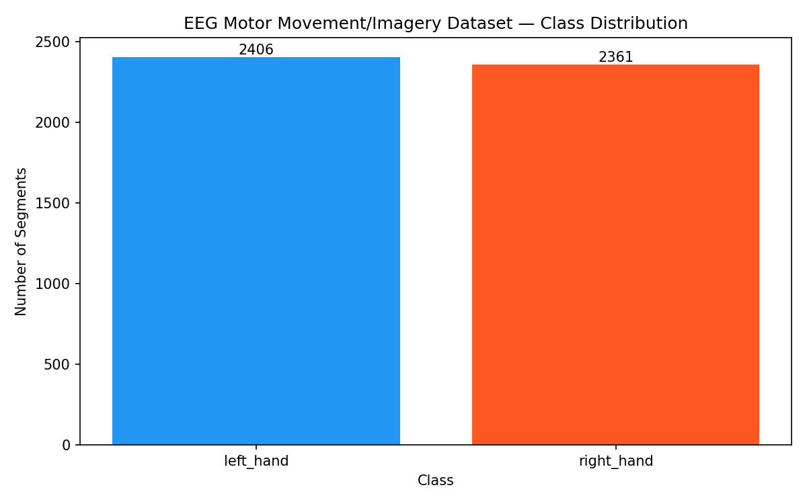
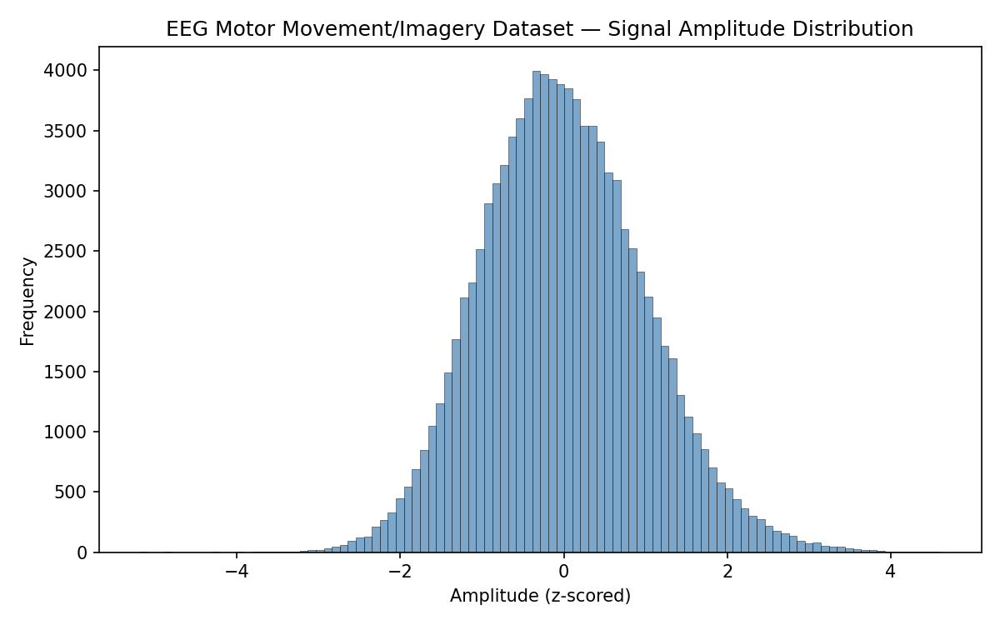
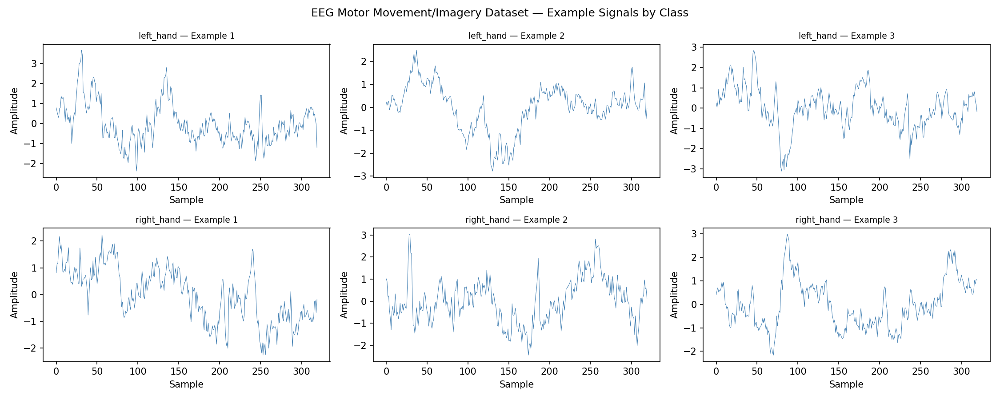

# Dataset Statistics: EEG Motor Movement/Imagery Dataset

## Metadata

| Property | Value |
|---|---|
| Dataset | EEG Motor Movement/Imagery Dataset |
| Source | https://physionet.org/content/eegmmidb/1.0.0/ |
| Subjects | 106 |
| Channels | 3 (C3.., Cz.., C4..) |
| Sampling Rate | 160.0 Hz |
| Segments | 4767 |
| Samples/Segment | 320 |
| Window Duration | 2.00 sec |

## Signal Statistics

| Statistic | Value |
|---|---|
| Mean | -0.000000 |
| Std Dev | 1.000000 |
| Min | -5.200975 |
| Max | 6.808003 |
| Median | -0.048443 |

## Class Distribution

| Class | Count | Percentage |
|---|---|---|
| left_hand | 2406 | 50.5% |
| right_hand | 2361 | 49.5% |

## Figures

