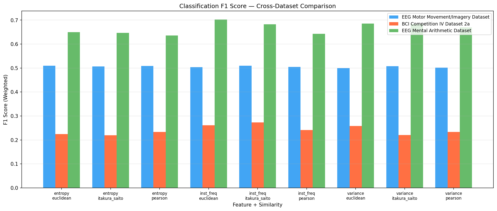
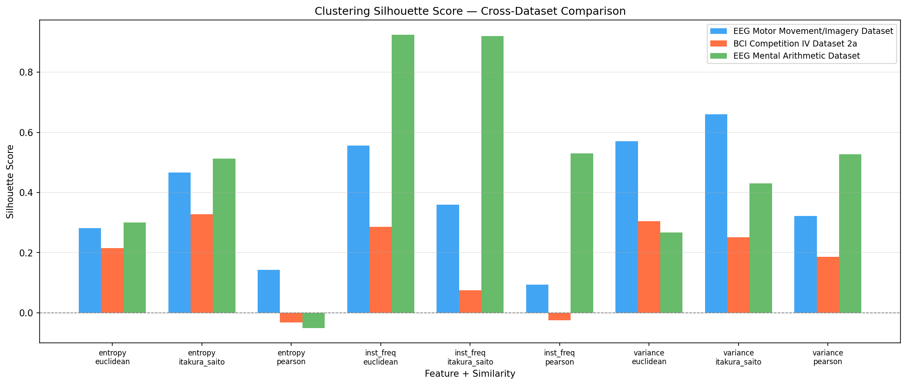
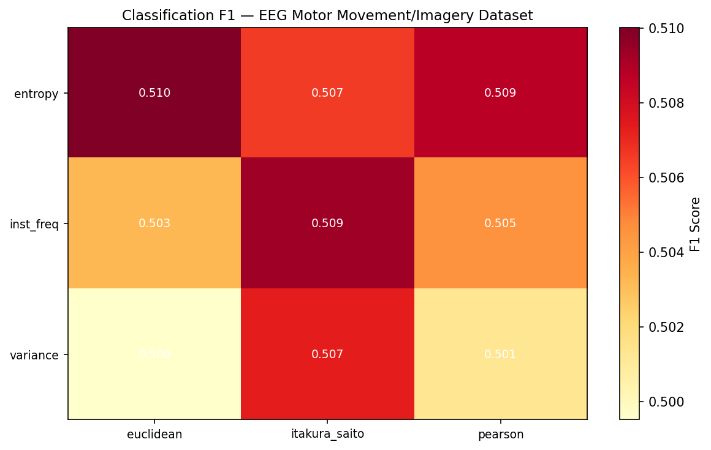
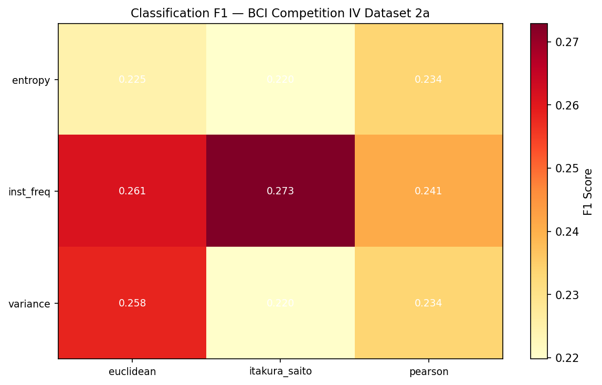
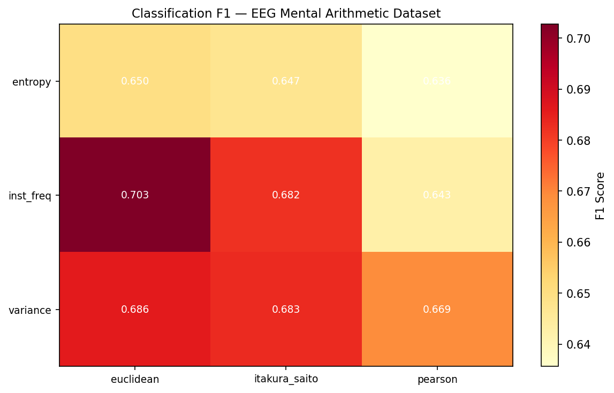
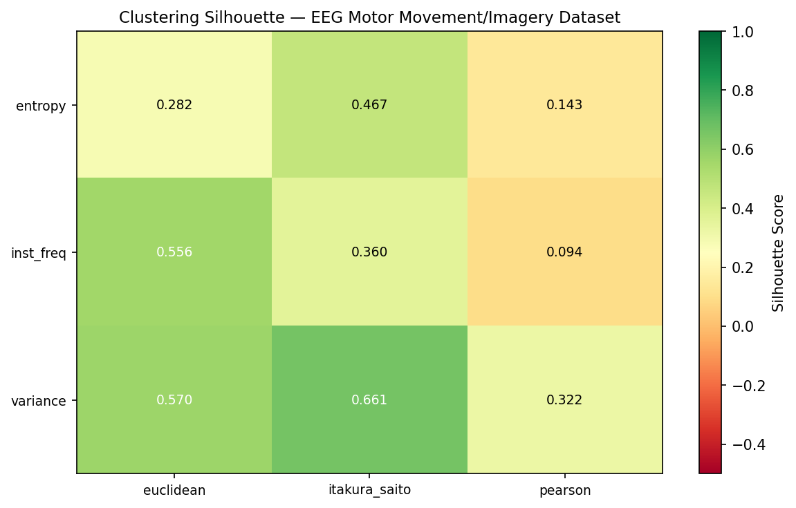
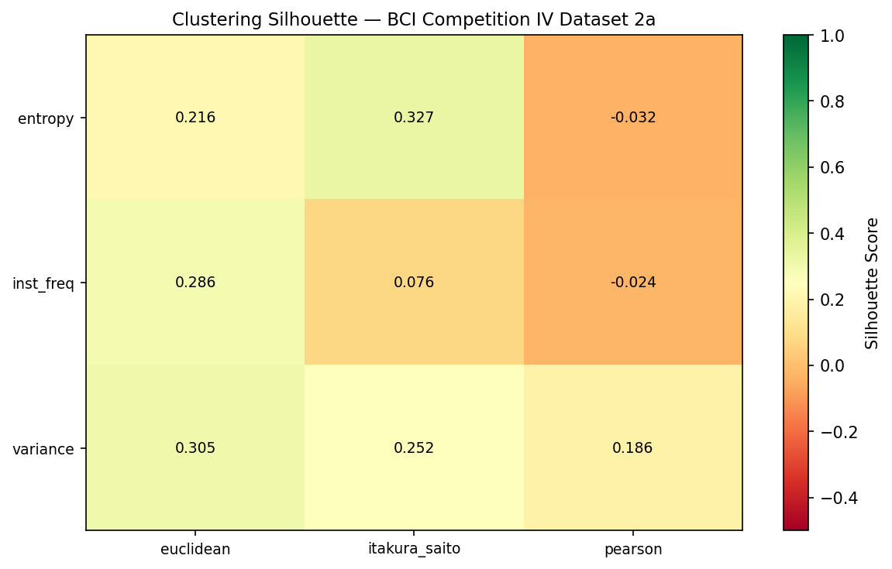
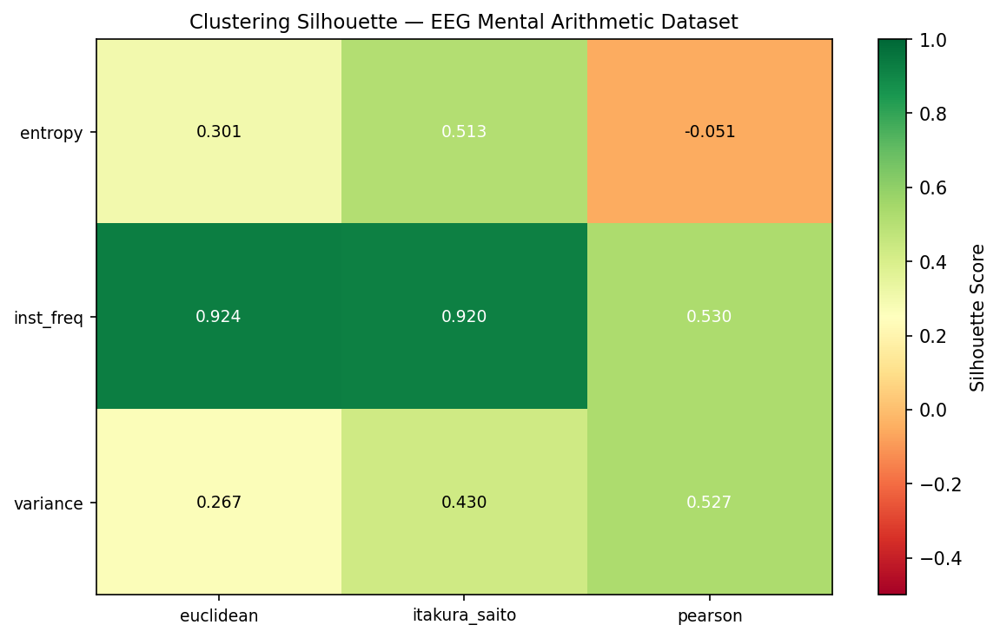
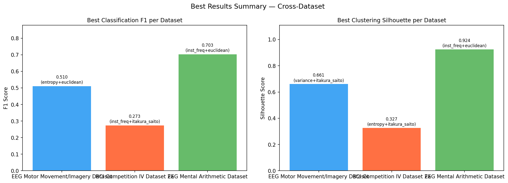

# Cross-Dataset Comparison

## Classification Results (F1 Score)

|                                |   bci_civ_2a |   eeg_ma |   eeg_mmi |
|:-------------------------------|-------------:|---------:|----------:|
| ('entropy', 'euclidean')       |     0.224584 | 0.649552 |  0.510011 |
| ('entropy', 'itakura_saito')   |     0.219787 | 0.647236 |  0.506566 |
| ('entropy', 'pearson')         |     0.233581 | 0.635612 |  0.508714 |
| ('inst_freq', 'euclidean')     |     0.261257 | 0.702751 |  0.503235 |
| ('inst_freq', 'itakura_saito') |     0.272875 | 0.682135 |  0.50935  |
| ('inst_freq', 'pearson')       |     0.240826 | 0.642553 |  0.50455  |
| ('variance', 'euclidean')      |     0.258241 | 0.685859 |  0.499514 |
| ('variance', 'itakura_saito')  |     0.220118 | 0.683294 |  0.507282 |
| ('variance', 'pearson')        |     0.233538 | 0.66914  |  0.501253 |

## Clustering Results (Silhouette Score)

|                                |   bci_civ_2a |     eeg_ma |   eeg_mmi |
|:-------------------------------|-------------:|-----------:|----------:|
| ('entropy', 'euclidean')       |    0.215806  |  0.300945  | 0.281697  |
| ('entropy', 'itakura_saito')   |    0.327209  |  0.513285  | 0.466652  |
| ('entropy', 'pearson')         |   -0.0320204 | -0.0505836 | 0.142859  |
| ('inst_freq', 'euclidean')     |    0.286325  |  0.924199  | 0.556019  |
| ('inst_freq', 'itakura_saito') |    0.0757689 |  0.920348  | 0.360211  |
| ('inst_freq', 'pearson')       |   -0.0238675 |  0.529938  | 0.0943419 |
| ('variance', 'euclidean')      |    0.304901  |  0.266634  | 0.569906  |
| ('variance', 'itakura_saito')  |    0.251522  |  0.430356  | 0.660598  |
| ('variance', 'pearson')        |    0.186398  |  0.527005  | 0.321882  |

## Classification Results (Balanced Accuracy)

Balanced accuracy is the mean per-class recall; chance is 0.50 for two classes and 0.25 for four, whatever the class balance.

|                                |   bci_civ_2a |   eeg_ma |   eeg_mmi |
|:-------------------------------|-------------:|---------:|----------:|
| ('entropy', 'euclidean')       |     0.230485 | 0.504373 |  0.509984 |
| ('entropy', 'itakura_saito')   |     0.226632 | 0.502256 |  0.506522 |
| ('entropy', 'pearson')         |     0.236928 | 0.487869 |  0.508663 |
| ('inst_freq', 'euclidean')     |     0.263924 | 0.572485 |  0.503523 |
| ('inst_freq', 'itakura_saito') |     0.278132 | 0.542162 |  0.509769 |
| ('inst_freq', 'pearson')       |     0.24854  | 0.49611  |  0.50452  |
| ('variance', 'euclidean')      |     0.260058 | 0.549288 |  0.499495 |
| ('variance', 'itakura_saito')  |     0.225363 | 0.54519  |  0.507443 |
| ('variance', 'pearson')        |     0.235607 | 0.528618 |  0.501458 |

## Clustering Agreement with the Classes (ARI)

K-Means does not use the distance measure, so the three rows of a feature share one partition; the adjusted Rand index (0 = chance) compares it with the true labels.

|                                |   bci_civ_2a |     eeg_ma |      eeg_mmi |
|:-------------------------------|-------------:|-----------:|-------------:|
| ('entropy', 'euclidean')       | -0.000134125 | -0.0230063 | -0.000174771 |
| ('entropy', 'itakura_saito')   | -0.000134125 | -0.0230063 | -0.000174771 |
| ('entropy', 'pearson')         | -0.000134125 | -0.0230063 | -0.000174771 |
| ('inst_freq', 'euclidean')     |  9.66297e-06 |  0.0274846 | -0.00019735  |
| ('inst_freq', 'itakura_saito') |  9.66297e-06 |  0.0274846 | -0.00019735  |
| ('inst_freq', 'pearson')       |  9.66297e-06 |  0.0274846 | -0.00019735  |
| ('variance', 'euclidean')      |  0.000747585 |  0.0354043 |  4.93739e-05 |
| ('variance', 'itakura_saito')  |  0.000747585 |  0.0354043 |  4.93739e-05 |
| ('variance', 'pearson')        |  0.000747585 |  0.0354043 |  4.93739e-05 |

## Comparison Figures

