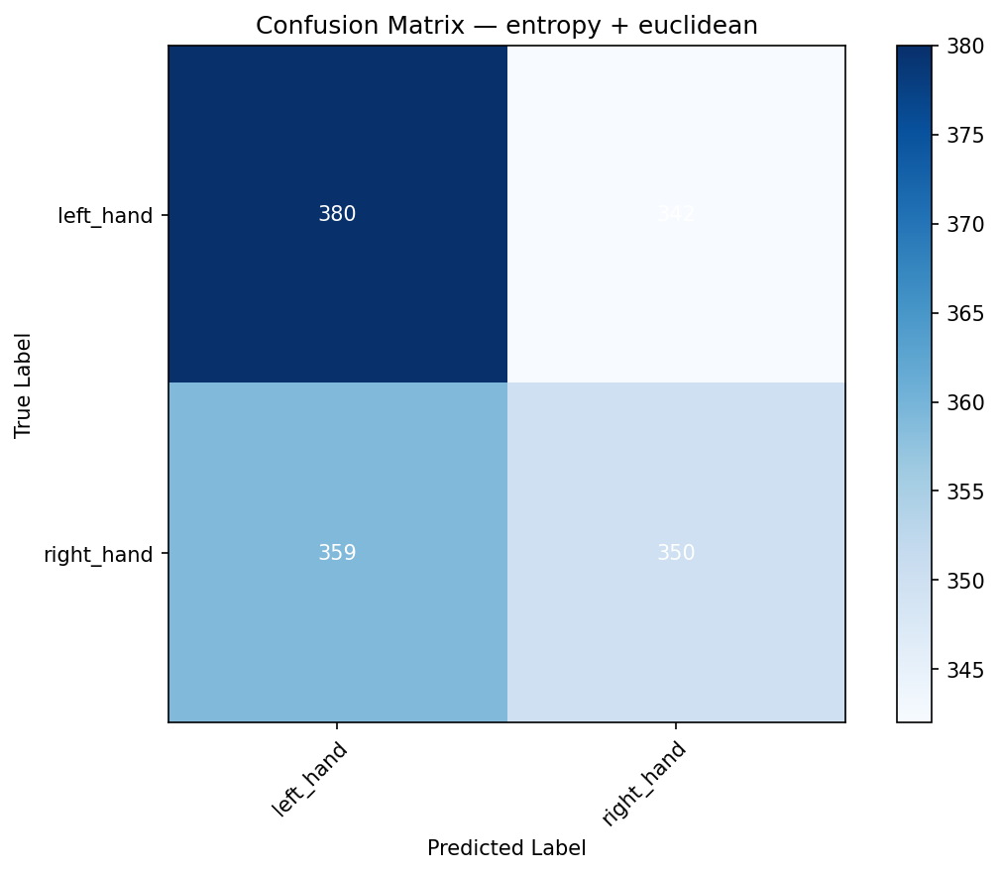
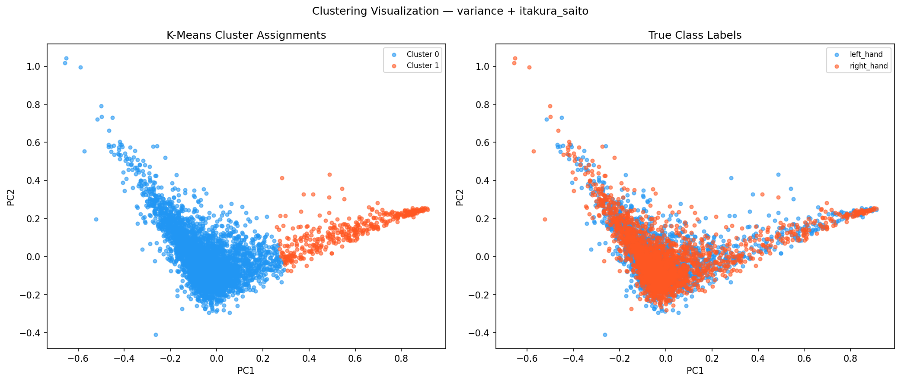
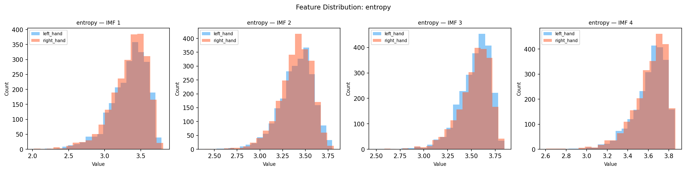
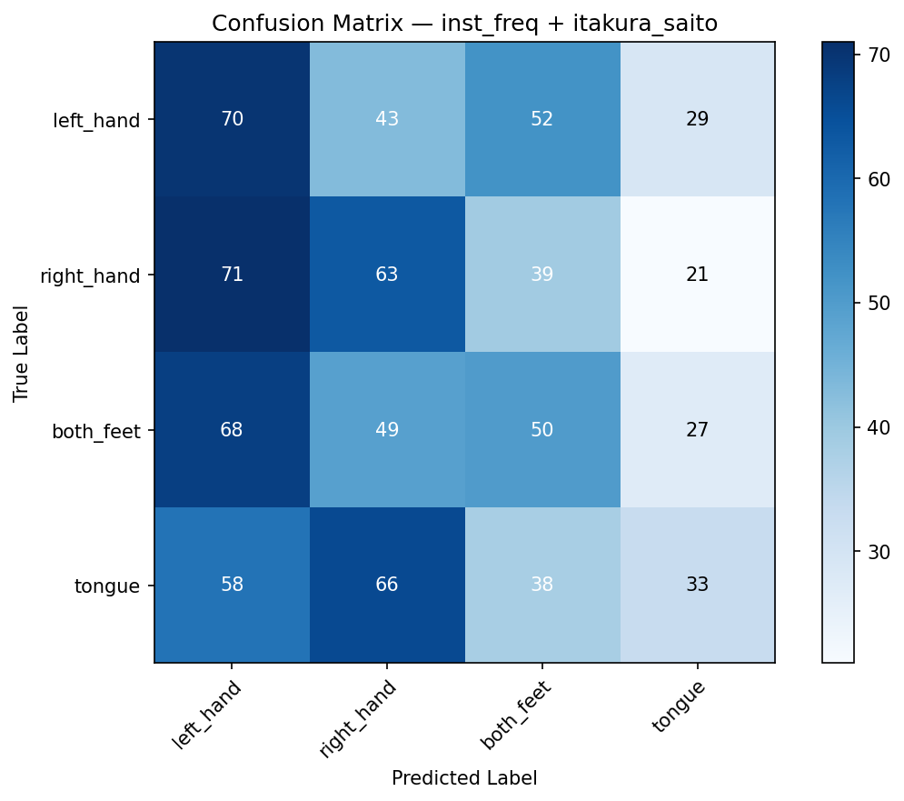
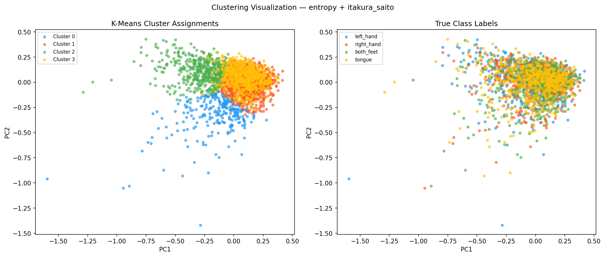
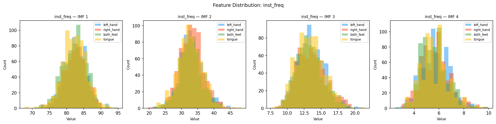
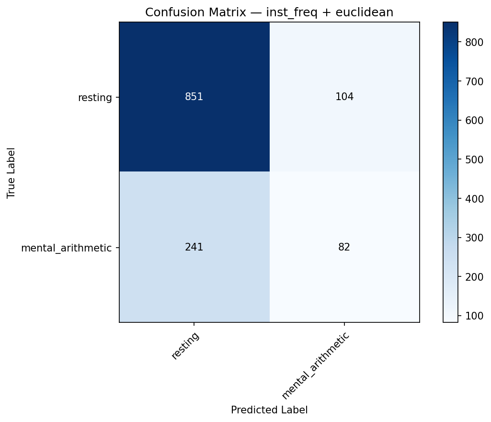
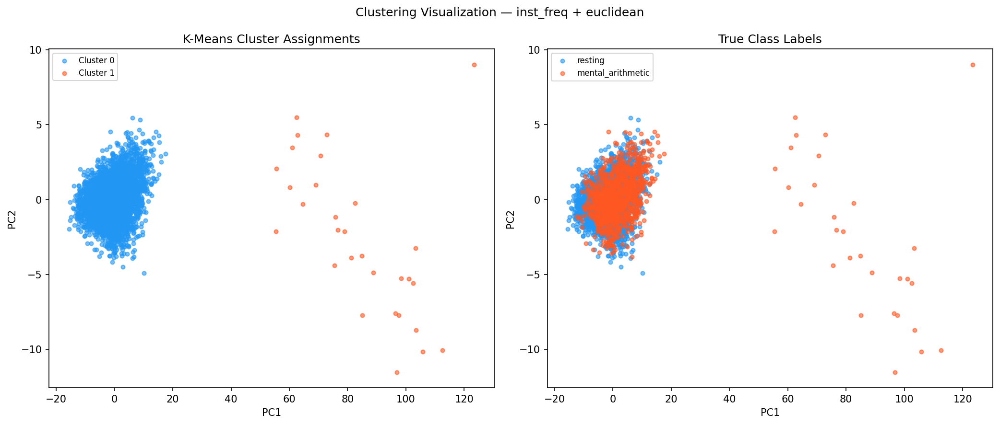
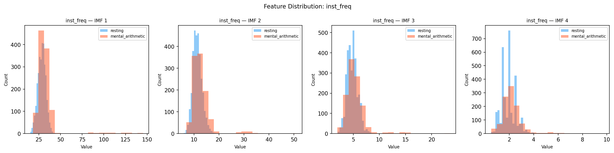

# Experiment Summary — EMD Signal Analysis

---

**Author:** Ryan Kamp  
**Affiliation:** Department of Computer Science, University of Cincinnati  
**Location:** Cincinnati, OH, USA  
**GitHub:** https://github.com/ryanjosephkamp

**Course:** CS7063 Advanced Machine Learning  
**Assignment:** Assignment 4 – ML for Signal Analysis using EMD  
**Date:** November 11, 2026

---

## Results Overview

### EEG Motor Movement/Imagery Dataset

#### Classification Results

| Feature | Similarity | F1 Score | Accuracy |
|---|---|---|---|
| entropy | euclidean | 0.5100 | 0.5101 |
| entropy | itakura_saito | 0.5066 | 0.5066 |
| entropy | pearson | 0.5087 | 0.5087 |
| inst_freq | euclidean | 0.5032 | 0.5038 |
| inst_freq | itakura_saito | 0.5094 | 0.5101 |
| inst_freq | pearson | 0.5045 | 0.5045 |
| variance | euclidean | 0.4995 | 0.4997 |
| variance | itakura_saito | 0.5073 | 0.5073 |
| variance | pearson | 0.5013 | 0.5017 |

#### Clustering Results

| Feature | Similarity | Silhouette Score |
|---|---|---|
| entropy | euclidean | 0.2817 |
| entropy | itakura_saito | 0.4667 |
| entropy | pearson | 0.1429 |
| inst_freq | euclidean | 0.5560 |
| inst_freq | itakura_saito | 0.3602 |
| inst_freq | pearson | 0.0943 |
| variance | euclidean | 0.5699 |
| variance | itakura_saito | 0.6606 |
| variance | pearson | 0.3219 |

#### Key Visualizations

### BCI Competition IV Dataset 2a

#### Classification Results

| Feature | Similarity | F1 Score | Accuracy |
|---|---|---|---|
| entropy | euclidean | 0.2246 | 0.2304 |
| entropy | itakura_saito | 0.2198 | 0.2265 |
| entropy | pearson | 0.2336 | 0.2368 |
| inst_freq | euclidean | 0.2613 | 0.2638 |
| inst_freq | itakura_saito | 0.2729 | 0.2780 |
| inst_freq | pearson | 0.2408 | 0.2484 |
| variance | euclidean | 0.2582 | 0.2600 |
| variance | itakura_saito | 0.2201 | 0.2252 |
| variance | pearson | 0.2335 | 0.2355 |

#### Clustering Results

| Feature | Similarity | Silhouette Score |
|---|---|---|
| entropy | euclidean | 0.2158 |
| entropy | itakura_saito | 0.3272 |
| entropy | pearson | -0.0320 |
| inst_freq | euclidean | 0.2863 |
| inst_freq | itakura_saito | 0.0758 |
| inst_freq | pearson | -0.0239 |
| variance | euclidean | 0.3049 |
| variance | itakura_saito | 0.2515 |
| variance | pearson | 0.1864 |

#### Key Visualizations

### EEG Mental Arithmetic Dataset

#### Classification Results

| Feature | Similarity | F1 Score | Accuracy |
|---|---|---|---|
| entropy | euclidean | 0.6496 | 0.6956 |
| entropy | itakura_saito | 0.6472 | 0.6909 |
| entropy | pearson | 0.6356 | 0.6878 |
| inst_freq | euclidean | 0.7028 | 0.7300 |
| inst_freq | itakura_saito | 0.6821 | 0.7230 |
| inst_freq | pearson | 0.6426 | 0.6909 |
| variance | euclidean | 0.6859 | 0.7199 |
| variance | itakura_saito | 0.6833 | 0.7199 |
| variance | pearson | 0.6691 | 0.7074 |

#### Clustering Results

| Feature | Similarity | Silhouette Score |
|---|---|---|
| entropy | euclidean | 0.3009 |
| entropy | itakura_saito | 0.5133 |
| entropy | pearson | -0.0506 |
| inst_freq | euclidean | 0.9242 |
| inst_freq | itakura_saito | 0.9203 |
| inst_freq | pearson | 0.5299 |
| variance | euclidean | 0.2666 |
| variance | itakura_saito | 0.4304 |
| variance | pearson | 0.5270 |

#### Key Visualizations

---

*This report was automatically generated as part of CS7063 Advanced Machine Learning, Assignment 4 – ML for Signal Analysis using EMD, November 2026.*
