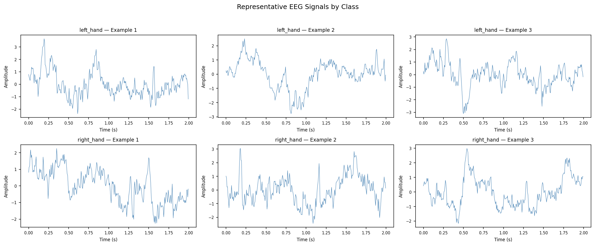
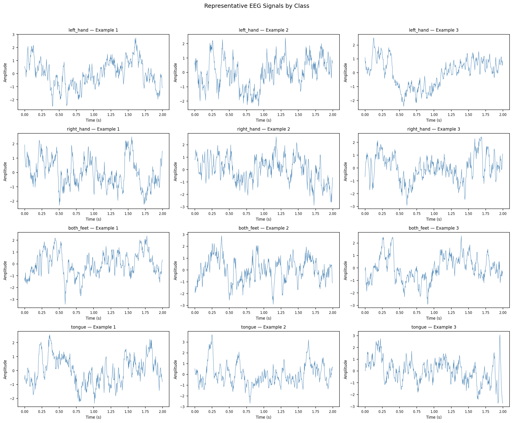
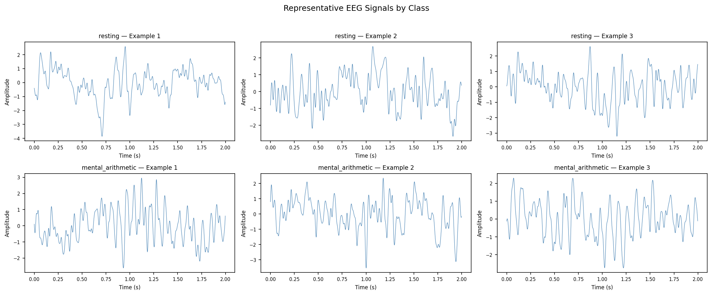
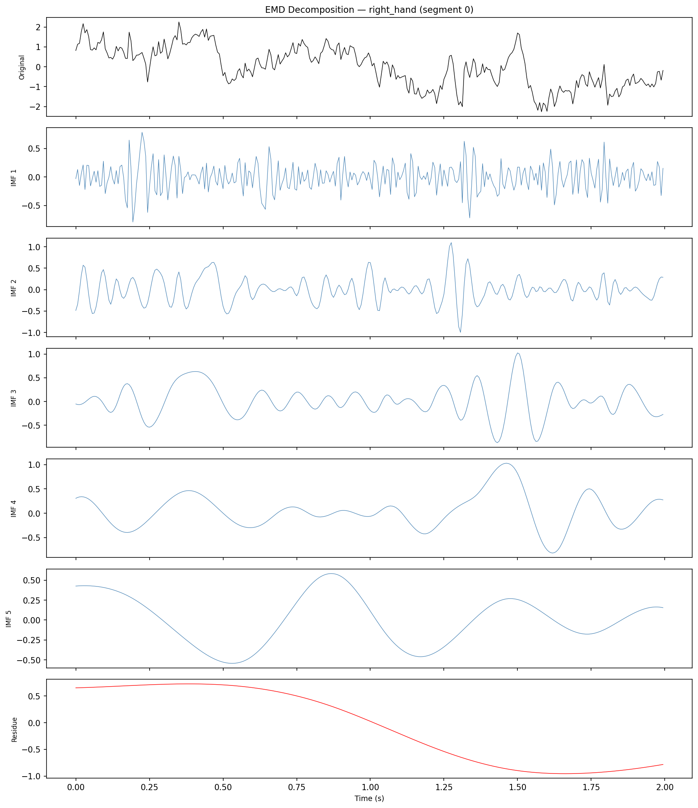
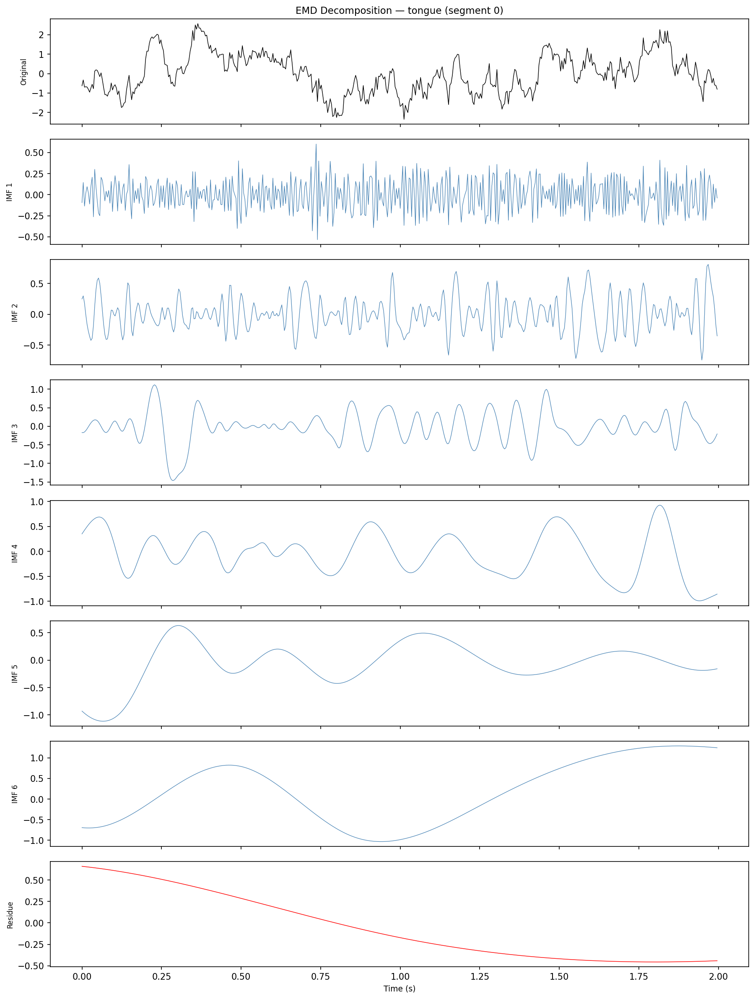
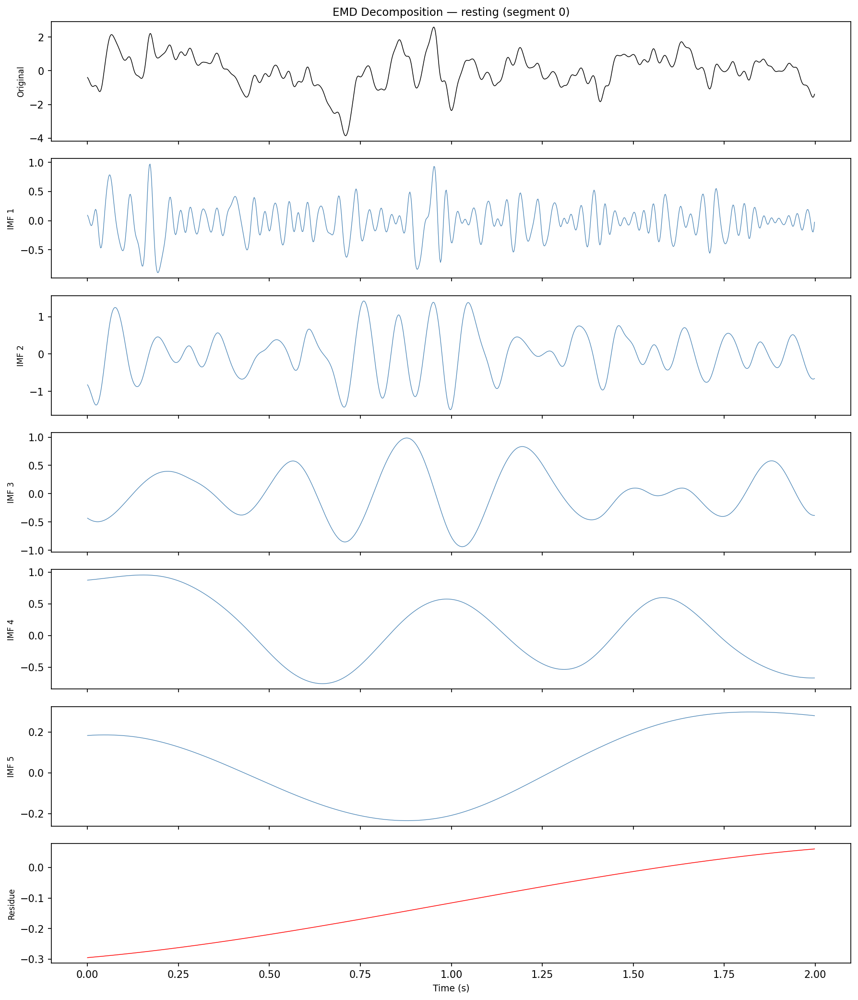
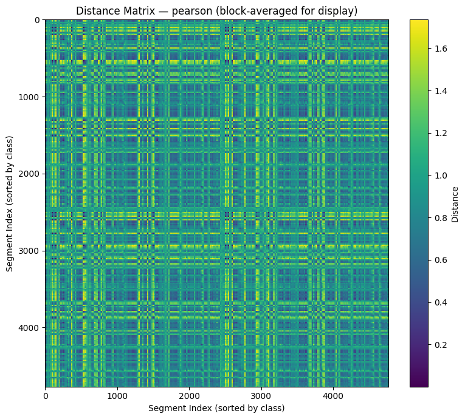
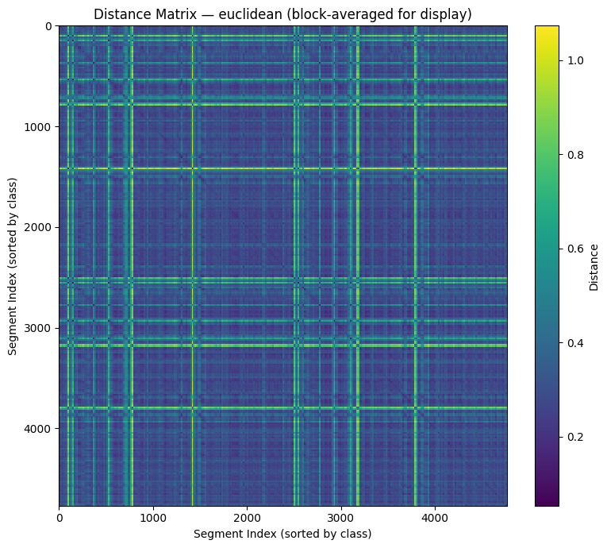
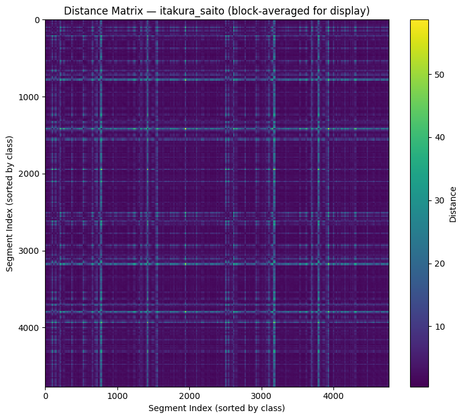

# Methodology Report — ML for Signal Analysis using EMD

---

**Author:** Ryan Kamp  
**Affiliation:** Department of Computer Science, University of Cincinnati  
**Location:** Cincinnati, OH, USA  
**GitHub:** https://github.com/ryanjosephkamp

**Course:** CS7063 Advanced Machine Learning  
**Assignment:** Assignment 4 – ML for Signal Analysis using EMD  
**Date:** November 11, 2026

---

## 1. Overview

This report describes the methodology used for the EMD-based signal analysis pipeline applied to EEG datasets. The pipeline follows five sequential tasks: signal preprocessing, EMD decomposition, feature extraction, similarity computation, and learning tasks.

## 2. Datasets

### EEG Motor Movement/Imagery Dataset

- **Source:** https://physionet.org/content/eegmmidb/1.0.0/
- **Subjects loaded:** 106
- **Channels:** C3.., Cz.., C4..
- **Sampling rate:** 160.0 Hz
- **Total segments:** 4767

### BCI Competition IV Dataset 2a

- **Source:** http://www.bbci.de/competition/iv/
- **Subjects loaded:** 9
- **Channels:** EEG-C3, EEG-Cz, EEG-C4
- **Sampling rate:** 250.0 Hz
- **Total segments:** 2590

### EEG Mental Arithmetic Dataset

- **Source:** https://physionet.org/content/eegmat/1.0.0/
- **Subjects loaded:** 36
- **Channels:** EEG Fp1, EEG Fp2, EEG F3, EEG F4, EEG Fz
- **Sampling rate:** 500.0 Hz
- **Total segments:** 4266

## 3. Preprocessing (Task 1)

- **Channel selection:** Motor cortex channels (C3, Cz, C4) for motor imagery datasets; frontal channels (Fp1, Fp2, F3, F4, Fz) for mental arithmetic.
- **Segmentation:** Fixed-length windows (2.0 seconds) starting at each cue (EEG MMI, BCI CIV 2a) or consecutive non-overlapping windows (EEG MA).
- **Quality checks:** EEG MMI files not sampled at 160 Hz are skipped; windows in which any channel is flat for 0.1 s or longer (clipping, or the padded end of each EEG MA recording) are dropped.
- **Normalization:** Z-score normalization per segment to ensure zero mean and unit variance.
- **Channel averaging:** Signals from selected channels averaged into a single time series per segment.

## 4. EMD Decomposition (Task 2)

- **Method:** Empirical Mode Decomposition (EMD) using the PyEMD library.
- **IMFs used:** The first n IMFs of every segment (default: 4), so each feature position always describes the same IMF; segments with fewer IMFs are skipped. No zero padding.
- **Residue:** The trend left after the last IMF, kept separately and not used as a feature.

## 5. Feature Extraction (Task 3)

Three feature types are computed from each IMF:

1. **Variance:** Measures the spread/power of each IMF. Computed as `np.var(imf)`.
2. **Entropy:** Shannon entropy of a 50-bin histogram of each IMF's amplitudes (the shape of the amplitude distribution, not the spectrum).
3. **Instantaneous Frequency:** Mean absolute instantaneous frequency derived from the Hilbert transform of each IMF.

Each feature type produces a vector of length `n_imfs` per segment.

## 6. Similarity Measures (Task 4)

Three distance/similarity measures are implemented:

1. **Pearson Correlation Distance:** $d = 1 - \rho$, range [0, 2].
2. **Euclidean Distance:** Standard L2 norm between feature vectors.
3. **Itakura–Saito Distance:** Symmetrized divergence measure, originally from speech processing. Requires strictly positive inputs.

## 7. Learning Tasks (Task 5)

### Classification
- **Algorithm:** K-Nearest Neighbors (KNN) with `metric='precomputed'`
- **Parameters:** k=5, 70/30 train/test split with stratification
- **Metrics:** Weighted F1-score, accuracy, balanced accuracy, macro F1, confusion matrix

### Clustering
- **Algorithm:** K-Means on feature vectors
- **Parameters:** n_clusters = number of true classes, n_init=10
- **Metrics:** Silhouette score under each distance matrix (cluster separation), and the adjusted Rand index and normalized mutual information against the true labels (class agreement). K-Means itself does not use the distance measure.

---

*This report was automatically generated as part of CS7063 Advanced Machine Learning, Assignment 4 – ML for Signal Analysis using EMD, November 2026.*
