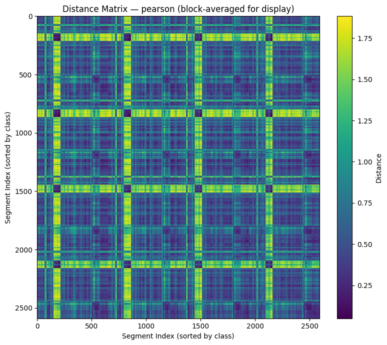
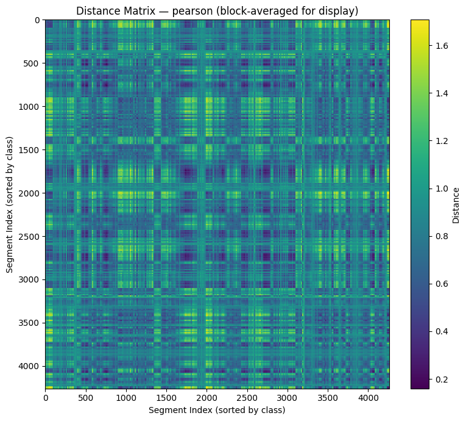
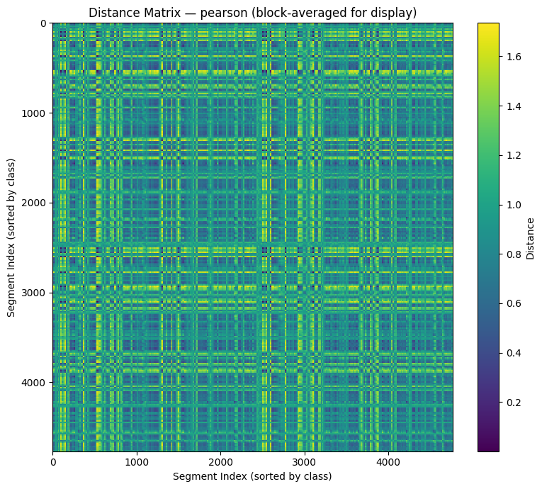
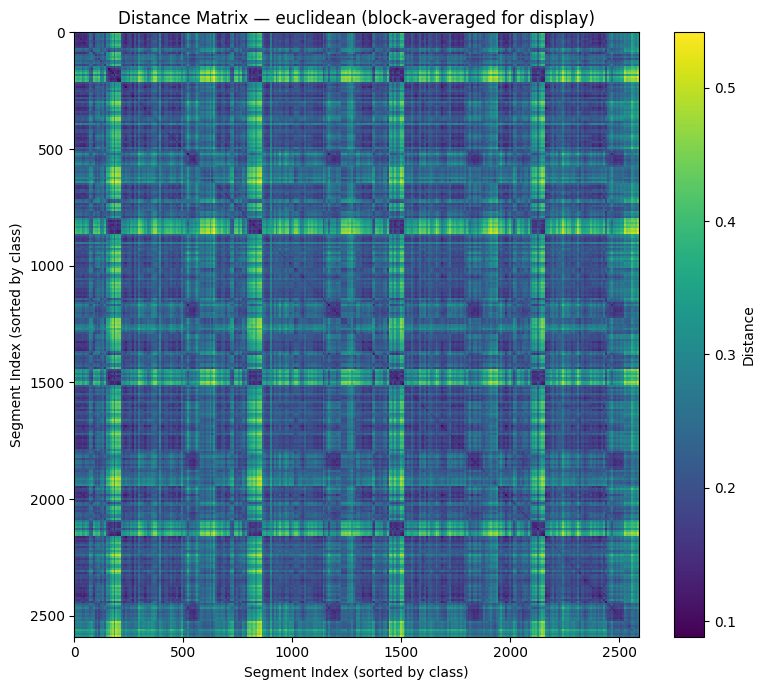
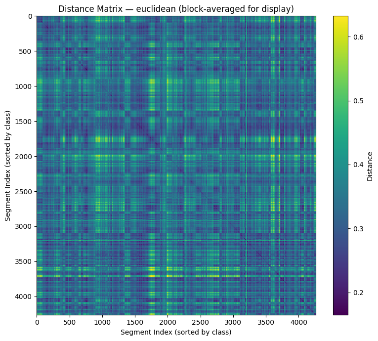
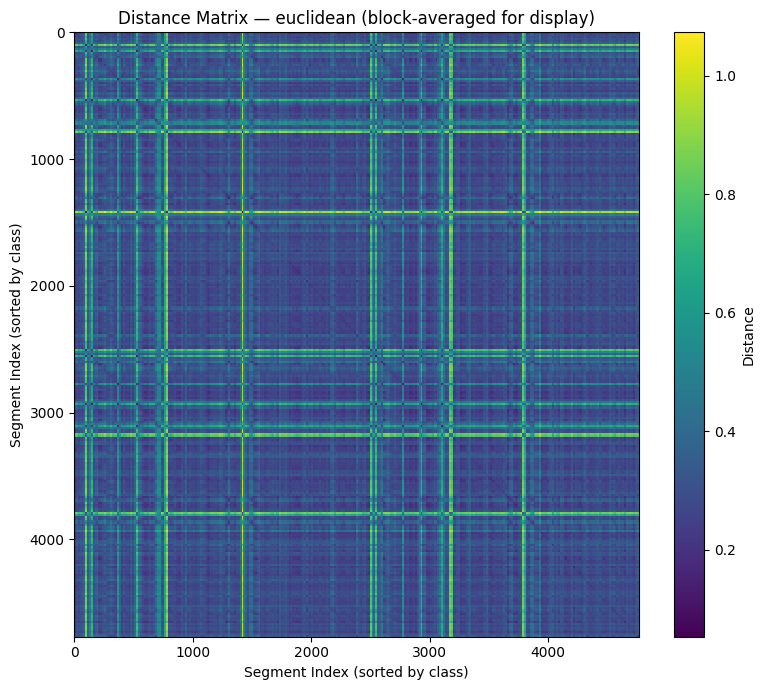
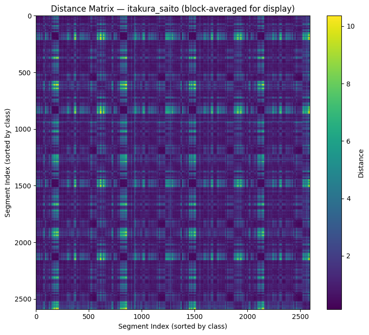
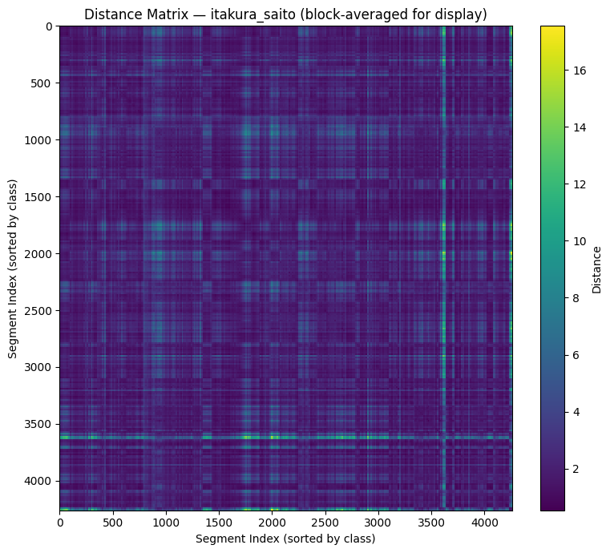
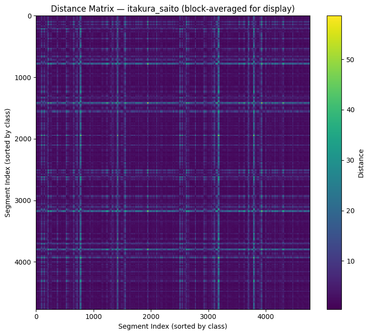

# Similarity Measures Description

---

**Author:** Ryan Kamp  
**Affiliation:** Department of Computer Science, University of Cincinnati  
**Location:** Cincinnati, OH, USA  
**GitHub:** https://github.com/ryanjosephkamp

**Course:** CS7063 Advanced Machine Learning  
**Assignment:** Assignment 4 – ML for Signal Analysis using EMD  
**Date:** November 11, 2026

---

## Overview

Three distance/similarity measures are used to quantify the similarity between EEG signals based on their IMF-derived feature vectors. Each measure produces a pairwise distance matrix used for classification (KNN) and clustering evaluation (silhouette score).

The distance matrix visualizations shown below are computed for each of the three EEG datasets used in this experiment. Each heatmap shows the pairwise distances between all signal segments in a given dataset, sorted by class label. Darker colors (purple) indicate smaller distances (more similar), while brighter colors (yellow) indicate larger distances (more dissimilar). The datasets are:

- **BCI Competition IV Dataset 2a** (`bci_civ_2a`)
- **EEG Mental Arithmetic Dataset** (`eeg_ma`)
- **EEG Motor Movement/Imagery Dataset** (`eeg_mmi`)

## 1. Pearson Correlation Distance

### Definition

The Pearson correlation coefficient measures the linear relationship between two feature vectors $\mathbf{x}$ and $\mathbf{y}$:

$$\rho_{xy} = \frac{\sum_{i=1}^{n}(x_i - \bar{x})(y_i - \bar{y})}{\sqrt{\sum_{i=1}^{n}(x_i - \bar{x})^2 \cdot \sum_{i=1}^{n}(y_i - \bar{y})^2}}$$

Converted to distance: $d = 1 - \rho$

### Rationale

Pearson correlation captures the *shape similarity* between IMF feature profiles regardless of absolute magnitude. Two signals with similar IMF energy distributions (even at different scales) will have high correlation and thus low distance. Range: [0, 2].

The following distance matrices show the Pearson correlation distance between all pairs of signal segments for each dataset. Each matrix corresponds to one of the three datasets:

## 2. Euclidean Distance

### Definition

$$d_{\text{Euc}}(\mathbf{x}, \mathbf{y}) = \sqrt{\sum_{i=1}^{n}(x_i - y_i)^2}$$

### Rationale

Euclidean distance measures the absolute difference in feature space. It is sensitive to both shape and magnitude differences. Signals with similar IMF variance/entropy/frequency profiles across all IMFs will have small Euclidean distance.

The following distance matrices show the Euclidean distance between all pairs of signal segments for each dataset:

## 3. Itakura–Saito Distance

### Definition

The Itakura–Saito divergence from $\mathbf{x}$ to $\mathbf{y}$:

$$D_{IS}(\mathbf{x} \| \mathbf{y}) = \sum_{i=1}^{n}\left[\frac{x_i}{y_i} - \log\frac{x_i}{y_i} - 1\right]$$

Symmetrized version used as the distance:

$$d_{IS}(\mathbf{x}, \mathbf{y}) = \frac{D_{IS}(\mathbf{x} \| \mathbf{y}) + D_{IS}(\mathbf{y} \| \mathbf{x})}{2}$$

### Rationale

The Itakura–Saito distance originates from speech/audio signal processing and is particularly suited for comparing spectral or energy-based features. It is scale-dependent and penalizes underestimation more heavily than overestimation, making it sensitive to the *ratio* between corresponding feature values rather than their absolute difference.

**Positivity handling:** The Itakura–Saito divergence requires strictly positive inputs. A zero-valued feature (for example the entropy of a constant IMF) is replaced with the smallest non-zero value in that feature dimension. In the symmetrized form the log terms cancel, leaving $\frac{1}{2}\sum_i (x_i/y_i + y_i/x_i - 2)$. The divergence is defined for power-like vectors such as IMF variances; on entropies and frequencies it is computable but has no spectral meaning.

The following distance matrices show the symmetrized Itakura–Saito distance between all pairs of signal segments for each dataset:

## Comparison

| Property | Pearson | Euclidean | Itakura–Saito |
|---|---|---|---|
| Scale invariant | Yes | No | No |
| Range | [0, 2] | [0, ∞) | [0, ∞) |
| Symmetric | Yes | Yes | Yes (symmetrized) |
| Positivity required | No | No | Yes |
| Best for | Shape similarity | Magnitude similarity | Spectral ratios |

---

*This report was automatically generated as part of CS7063 Advanced Machine Learning, Assignment 4 – ML for Signal Analysis using EMD, November 2026.*
